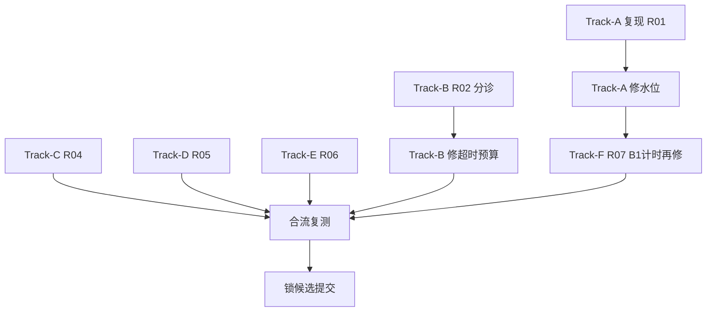

# FDE 打包门槛对齐 — 多 Agent 并行 Plan

| 元数据 | 内容 |
|---|---|
| 文档名称 | FDE 打包门槛对齐 — 多 Agent 并行 Plan |
| 文档类型 | Plan |
| 版本 | v0.1 |
| 撰写日期 | 2026-11-18 |
| 撰写人 | Cursor（Claude） |
| 委托人 | xingchen |
| 基于材料 | [FDE 检查报告](~/Nutstore Files/WIP@坚果云/lucy 升级相关/检查报告.md)（候选 `ff4762c9`）；[暂停 UAT 接力](lucy-20261118-p147-pause-uat-relay-plan.md)；提交 `dada75c2`（Chart 0.2.10＋暂停模拟 PASS） |
| 适用范围 | 关闭 FDE「源码准入」所列 **R01／R02／R04／R05／R07**（及适用的 **R06**），使候选可进入「构建 amd64 镜像与 Helm 包」；**不**代替客户现网升级验收 |
| 输出位置 | `docs/plans/lucy-20261118-fde-pack-gate-parallel-plan.md` |
| 状态 | **v0.1；委托人 2026-11-18「对齐 FDE 打包门槛，制定可并行计划并推进执行」＝本 Plan 开工授权** |
| 授权边界 | **已授权**：本 Plan 各 Wave 的分诊、复现、修复、单测／适用 UAT、门禁复跑、总账回写。**未授权**：客户生产升级、宣称正式客户包可发出（须制品＋原生升级另验）。暂停交付仍可作为并行缓解包，**不代替** R07 默认配置关单 |
| 验收 | 见 §验收 |

> **For agentic workers:** 按 Wave 并行；**禁止**两名 agent 同时改 `webui/server/proxy/audit.ts`（R01 与 R07 串行）。门禁轨与 R02 可与 R01 并行。

**Goal:** 对齐 FDE 源码打包门槛：正确性（R01）、字段读预算（R02）、安全／质量／文档门禁（R04–R06）、默认配置重建性能（R07）；R03 已在 `dada75c2` 关闭。

**Architecture:** 三波并行。Wave1＝无共享运行时冲突的分诊／复现；Wave2＝R01 修复落盘后再开 R07 根治（同文件串行）；Wave3＝合流复测锁候选。暂停路径已模拟 PASS，制品线可与 Wave2 文档／门禁并行准备，但正式「默认配置」放行仍等 R07。

## Global Constraints

- FDE 报告候选＝`ff4762c9`；当前接力头＝`dada75c2`（含暂停／Helm）。修复落在其后新提交。
- **R03 已关**（Chart 0.2.10）；不再占用带宽。
- **暂停 ≠ R07 关闭**；默认配置 RPB／COLD 门槛仍必须过。
- 改运行代码须同步 Spec／总账同句；不入核心分母的事故项保持「≠ 可上线」。
- 客户 hive 真连、原生 amd64 升级＝制品阶段，不在本 Plan 完成定义内冒充 PASS。

---

## 1. 目标与 FDE 映射

| FDE | 级别 | 本 Plan 轨道 | 关闭定义（源码准入） |
|---|---|---|---|
| R01 | P0 | Track-A 水位／覆盖一致性 | 并发新增写入重建窗：最终关联完整；不得「未处理却 complete＋watermark 盖住」；vitest＋可复现脚本 PASS |
| R02 | P1 | Track-B 字段读超时预算 | 单次读取共用总预算；超时停无效重试；vitest 虚拟时钟／既有探针 PASS；真实 hive 记 BLOCKED 不挡源码关单（与 FDE「暂列 P1」一致） |
| R03 | P1 | **DONE** | Chart 0.2.10 已下发 `LUCY_INFERRED_MAINTAINER` |
| R04 | P1 | Track-C 依赖安全 | `npm audit`／dependency gate 过或书面 not_reachable＋重锁 |
| R05 | P1 | Track-D 质量门禁 | 标准 `npm test`、适用 typecheck、合同入口绿或逐项定因关闭 |
| R06 | P1 | Track-E 发布／文档 | 适用 release-ledger／spec-docs／工具面一致性；镜像 digest 等留制品阶段 |
| R07 | P0 | Track-F 默认重建性能 | 默认维护器开：RPB-01 livez max≤1000／p99≤400；COLD 首次／重启达门槛；暂停不计入关单 |

## 2. 并行拓扑

| Wave | 并行 Agent | 改动面 | 依赖 |
|---|---|---|---|
| **1** | A-repro、C、D、E、B-triage | 证据／inbox／门禁报告；**不**改 `audit.ts` | 无 |
| **2a** | A-fix | `audit.ts`、`inferred-turn-maintainer.ts`、vitest | Wave1 A-repro |
| **2b** | B-fix | schema-structure／字段读路径 | Wave1 B-triage；**不**碰 audit 重建 |
| **2c** | F | `audit.ts` 重建 I/O（**等 2a 合并后**） | Wave2a |
| **3** | 协调者 | 全量适用门禁＋RPB／COLD 默认配置＋总账 | 2a／2b／2c／C／D／E |

## 3. Track 任务卡

### Track-A｜R01 水位／覆盖（P0）

**根因（已证实）：** 读页冻结 `ceilingId=MAX(id)`，完成水位却写 `MAX(ts)`；`covered()` 只比 ts → 重建中插入且 `id>ceiling`／`ts≤watermark` 的行无关联却被判已覆盖。

**Files：** `audit.ts`、`inferred-turn-maintainer.ts`、`rebuild-watermark-race.test.ts`（新）等。证据：`inbox/fde-r01-fix-summary.md`。

- [x] **A1** 复现＋红灯用例（`rebuild-watermark-race.test.ts`）。
- [x] **A2** 水位＝`String(ceilingId)`；`covered()` 按 id；历史 ISO 水位→未覆盖。
- [x] **A3** vitest：recovery + cold-start + watermark-race **23 passed**（协调者复核同绿）。
- [x] **A4** Spec §3.1 注记＋总账 P1-50「代码已实现」。  
  → [R01 水位修复](8f937928-a5d0-45c9-8cef-585d54bc62e2)；**未 commit**。

### Track-B｜R02 字段读超时（P1）

**Files（预期）：** `webui/server/schema-structure.ts`、`schema-structure-batch.ts`、相关 vitest  
**总账裁定：** 新 **P1-51**（或 P1-34 addendum）；**不**并入 P1-43。

- [x] **B1** 定位 8s×3／总预算 10s 仍跑 24s 的代码路径。  
  → [R02 分诊](793eb126-bc46-4099-b573-31946693c073)：`inbox/fde-r02-triage.md`。洞 1＝Hive 超时被误判 `unreadable` → 仍跑满 3×8s；洞 2＝MySQL `chunksFinished>0` 才 defer → 首次 split 树可烧穿预算。
- [x] **B2** 整次预算共享；`timeoutMs=min(8s, remaining)`；超时正确分类并停止 Hive 无效重试；MySQL 首次后每次 columns 前查预算；保留语法兼容回退顺序。Spec SC **LS-16–18**（P1-34 Spec v0.2.2）。
- [x] **B3** vitest PASS（虚拟时钟）；真实 hive 记 BLOCKED（不挡源码关单）。

### Track-C｜R04 依赖安全（P1）

- [x] **C1** 复跑 WebUI `npm audit`／dependency gate；摘 high／zod GHSA。
- [x] **C2** 升级／替换或 not_reachable 书面依据；重锁；门禁绿。  
  → [R04 依赖](58580abe-f777-46af-b476-c2ff8c057be8)：`zod` `4.4.3` → `4.6.7`；`--omit=dev` high/critical=0；`crossCheckDependencies` passed。剩 1 low + 5 moderate（fast-uri／fastify／mysql2）不挡 high/critical 门禁。

### Track-D｜R05 质量门禁（P1）

- [x] **D1** 分类：术语 4、typecheck 33、vitest 大量 `mark.id` 替身 → 见 [`inbox/fde-r05-triage.md`](../../inbox/fde-r05-triage.md)。
- [x] **D2** 术语 4 处 `notranslate`；共享 `audit-db-stub` 批量修 mark.id；`npm run pretest` **PASS**，`npm test` 可进 vitest。  
  → [R05 质量门禁](d6f8804b-5f0a-43a8-8743-2365f9c27206)。抽查：auth／email／semantic／branding 绿；`token-renewal-closure` **20 fail**（5s timeout／契约，非 mark.id）。
- [x] **D3** `token-renewal-closure` **21/21**（harness：`FROM access_log` 一律 `{cnt}` → `scanFullOnce` 死循环；收窄为 `COUNT(*)`）。  
  → [token-renewal 修复](271d0ae6-528a-4be5-b5c4-7a99b19bee8f)。typecheck ~33 仍另桶；全量 vitest 未宣称关单。

### Track-E｜R06 发布／文档（P1）

- [x] **E1** 列出失败门禁命令与最小修补集（release-ledger、livez／readyz API 文档、spec-docs、Ops 手册 6 工具）。  
  → [`inbox/fde-r06-triage.md`](../../inbox/fde-r06-triage.md)。
- [x] **E2** 只修源码／文档侧可关项；digest／包 SHA 留空位注明「制品后填」。  
  → 已关：`lint:release-ledger`、`lint:spec` api-spec（livez／readyz／audit/status）、`lint:handbook-tool-surface`（27 工具）。**Deferred**：`lint:spec-docs` 167 条基线外违规（基线只减不增；非 Track-E 可关范围）。

### Track-F｜R07 默认重建性能（P0）

- [x] **F1** B1 分段计时（`LUCY_REBUILD_TRACE=1`）：写片／提交／WAL／读页占比 → [`inbox/fde-r07-trace.md`](../../inbox/fde-r07-trace.md)。
- [x] **F2** 据 F1 选最小手段：`wal_autocheckpoint=100`＋写片前 sources 预取＋片间 `wal_checkpoint(PASSIVE)`（未做 worker／写连接分离）。Spec v0.4／总账 v1.43。
- [x] **F2+**（R07 第二轮）：`wal_autocheckpoint=50`＋写片后必让出＋PASSIVE busy 延后重试＋写片 INITIAL 4／MAX 16。Spec v0.5／总账 v1.44。证据 [`inbox/fde-r07-trace.md`](../../inbox/fde-r07-trace.md)。
- [x] **F2++**（R07 第三轮）：`wal_autocheckpoint=25`＋写片 INITIAL 3／MAX 12＋tiny residual 可跳过 PASSIVE（每 3 片强制一次）。Spec v0.6／总账 v1.45。证据 [`inbox/fde-r07-trace.md`](../../inbox/fde-r07-trace.md)。写连接分离仍不做。
- [ ] **F3** **默认配置**（无 pause env）复跑 RPB-01／02／03 与 COLD-02／03；达 Spec 门槛。（协调者）  
  → 2026-11-18-r07-default-on：`rpb01=false`（livez **max 650✓／p99 500✗**）。  
  → `r07-p99-2`：max **620✓**／p99 **441✗**（较 500 再降；仍差 ~41ms）。  
  → 协调者已启动 upgrade＋RPB **`r07-p99-3`**（[R07 p99 三轮](9242213c-23e3-4f28-bfad-d44ca4627179)；日志 `inbox/fde-r07-rpb-p99-3.log`）。

## 4. 总账编号

| 轨道 | 建议总账 | 说明 |
|---|---|---|
| R01 | **P1-50／REQ-030-071**（新建） | 重建快照与水位一致性 |
| R02 | **P1-51**（新）或 P1-34 addendum | Wave1 裁定：**不**并入 P1-43；见 `inbox/fde-r02-triage.md` |
| R04–R06 | 不入产品功能行；总账变更行记「打包门禁轨」 | |
| R07 | 既有 **P1-47** B 线 | 根治关单 |

## 5. 风险

| 风险 | 处理 |
|---|---|
| R01／R07 同改 `audit.ts` | Wave2c 必须 rebase 在 2a 之后 |
| R05 海量失败 | 先修入口阻塞与替身；真缺陷单列，不虚报全绿 |
| R07 一日内不达标 | 保留暂停交付包并行；源码准入对 R07 仍标 OPEN 并升级风险 |
| FDE 报告路径在坚果云 | 引用路径，不把私有证据拷进 git 除非必要摘要 |

## 6. 验收

- R01／R02／R04／R05／R07 关闭要求在 §1 表达成；R06 适用项关闭。
- 默认配置 RPB-01 PASS；暂停路径回归不破坏。
- `gate:k8s-static` 仍绿；Chart 保持可下发暂停。
- 总账＋e2e-ledger＋INDEX 同句；**≠ 可上线**直至制品／原生升级。

## 完成定义

源码准入清单在仓库内有证据可勾选 → 允许启动 amd64 客户待测包构建。正式客户交付仍走 C01–C20 与原生升级。
