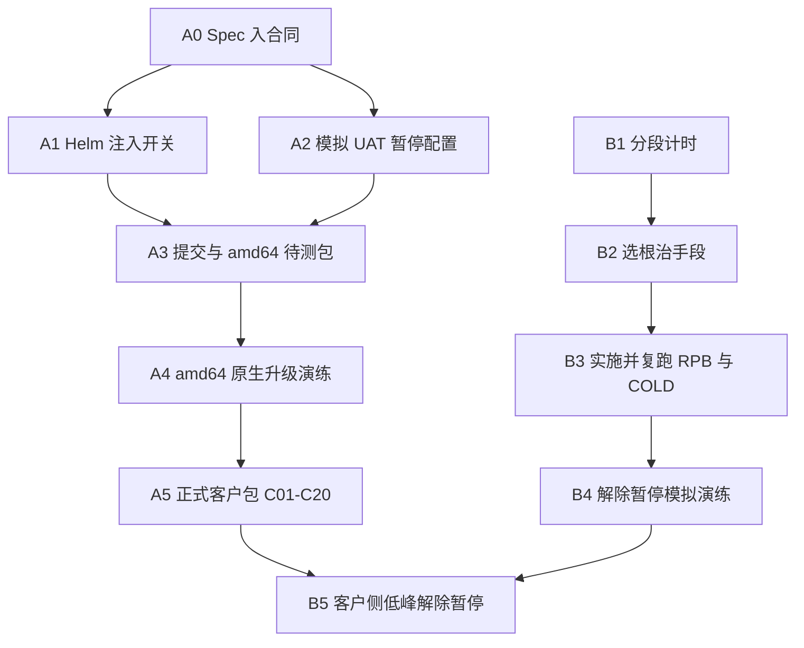

# P1-47 暂停交付与根治并行计划

| 元数据 | 内容 |
|---|---|
| 文档名称 | P1-47 暂停交付与根治并行计划 |
| 文档类型 | Plan |
| 版本 | v0.1 |
| 撰写日期 | 2026-11-18 |
| 撰写人 | Cursor（Claude） |
| 委托人 | xingchen |
| 基于材料 | [升级放行评估](../reviews/2026-11-18-p145-p147-upgrade-readiness-assessment.md)；[暂停开关对照跑次](../qa/uat/suites/rebuild-probe-budget/runs/2026-11-18-cursor-rpb-p147-pause-control.md)；[P1-47 Spec](../specs/lucy-20261118-rebuild-probe-budget-spec.md)；[客户 amd64 出包清单](../runbooks/customer-amd64-image-build-checklist.md)；[客户升级交付清单](../runbooks/customer-v2-upgrade-release-checklist.md)；Helm Chart `deploy/k8s/helm/lucy/` |
| 适用范围 | 编排「先带暂停开关交付，让用户的 MCP 先回复；同步根治后再解除暂停」两条线。**所有 UAT 为 Docker 限速台上的模拟 UAT，不等于客户现场 PASS** |
| 输出位置 | `docs/plans/lucy-20261118-p147-pause-delivery-and-root-fix-plan.md` |
| 状态 | **v0.1；待委托人确认 §6 的三个决策点后开工。** 委托人 2026-11-18 已批准方向：「先完全暂停，让用户的 MCP 回复，再同步修正」；优先级＝**升级与 MCP 回复第一，日志第二**。**接力执行 Plan**（UAT 优先验证回滚根因）：[lucy-20261118-p147-pause-uat-relay-plan.md](lucy-20261118-p147-pause-uat-relay-plan.md) |
| 授权边界 | 已授权：暂停开关（已实现）、A 线与 B1 分段计时。**未授权**：提交 git、B2 的具体手段（`wal_autocheckpoint`／worker）、线上升级。≠ 可上线 |
| 验收 | 见 §8 |

## 1. 目标与假设

- **目标**：升级后客户的 MCP 回复稳定可用（readyz／livez 不超 3 秒探针预算）。审计页「问询」归并的新鲜度可暂时让位，数据不丢。
- **假设（请纠正）**：
  1. 「模拟 UAT」指 Docker 限速台（blkio 30MB/s、读 300／写 100 IOPS）上的受控验证，不触客户环境；结果只写「模拟 PASS」。
  2. 暂停开关的默认仍是开；**只有客户测试包的实例配置把它置为 `off`**，不改变 demo 与其他使用者的行为。
  3. 先出**待测包 `*-test`**，在自备 amd64 环境验平滑升级，通过后再按 C01–C20 出正式客户包。

## 开工前置

- 委托人确认 §6 的 D1／D2（A3 起需要 D1；A1 需要 D2）。D3 在 B1 出数据后再定。
- 工作树为当前 `lucy-v0.30`；暂停开关、P1-45／46／47 代码仍在工作树，未提交。
- 总账已登记（v1.36、v1.37）；未授权项不改运行代码。

## 2. 总览

文字版：A 线（交付）A0→A1∥A2→A3→A4→A5；B 线（根治）B1→B2→B3→B4；两线在 B5 汇合——只有 B4 通过、且 A5 已交付，才在客户侧用 Helm values 解除暂停。A 线与 B 线可并行。

## 3. A 线：暂停交付（先让 MCP 回复）

| 步骤 | 内容 | 验证方式 | 改动面 |
|---|---|---|---|
| A0 | P1-47 Spec 升 v0.3：把暂停开关写进合同。SC-08：默认开，行为不变；`off` 时不创建维护器；状态如实返回 `paused`。SC-09：暂停配置下 RPB-01 达 Spec 门槛。SC-10：暂停配置下 MCP 回复主路径可用。登记「暂停≠修复」 | `lint:spec-docs`；`check-e2e-ledger` | `docs/specs/`、总账 |
| A1 | Helm 注入：`_helpers.tpl` 增加 `LUCY_INFERRED_MAINTAINER` 白名单（空则不下发）；`values.yaml` 增 `env.LUCY_INFERRED_MAINTAINER: ""`；Chart 内容变化，按规则升 Chart 版本 | `helm template` 渲染「空／off」两态；`npm run gate:k8s-static`；G8 | `deploy/k8s/helm/lucy/` |
| A2 | 模拟 UAT（见 §5）：暂停配置的满量重建、首次升级、重启、MCP 回复、状态披露 | 各用例判定；跑次入 [INDEX](../qa/uat/INDEX.md) | `scripts/uat/`、`docs/qa/uat/` |
| A3 | **经委托人确认后**提交；干净树构建 `linux/amd64` 单架构镜像，`*-test` 后缀 | `bash scripts/release/build-customer-amd64-image.sh`：G1–G4d、G8；`BUILD_REVISION` 等于提交且无 `-dirty` | 构建 |
| A4 | 在**自备 amd64 原生环境**用原 PVC 做 0.25→待测包升级，实例 values 置 `env.LUCY_INFERRED_MAINTAINER: off`；备份、回滚演练；记录升级期间 readyz／livez 序列；用真实 MCP 客户端问数 | C12／C15／C16 子集；readyz 无连续 6 次失败；问数返回正确 | 委托人环境 |
| A5 | 正式客户包：按 C01–C20 逐项（已有管理员则 C04／C05 记 N/A 并核实原状态）；随包说明暂停影响；向客户索取 fsync、`audit.sqlite*` 文件大小、故障 Pod 启动五分钟日志 | C01–C20 PASS／N/A；说明随包 | 出包流水线 |

**A2 全部 PASS 才进入 A3；A3 的 G 门禁全过才进入 A4。**

## 4. B 线：同步根治

| 步骤 | 内容 | 验证方式 | 授权 |
|---|---|---|---|
| B1 | 重建分段计时：环境变量门控（如 `LUCY_REBUILD_TRACE=1`），只加日志，记录每个写片耗时、提交耗时、WAL 大小、`sourcesFor` 耗时、读页耗时。不暂停复跑 RPB-01，输出各段占比 | 一份分段报告；确认停顿主因 | **已授权** |
| B2 | 按 B1 数据选手段：(a) 审计库 `wal_autocheckpoint` 调小，把大检查点拆成小片；(b) 重建写入放到独立 worker 连接；(c) 写片事务外预取 `access_log_sources`。可组合 | 方案说明＋风险；回滚方式 | **待委托人确认（D3）** |
| B3 | 实施，补单测；**不暂停**复跑 RPB-01／02／03 与 COLD-02／03／04 | livez max ≤1000ms、p99 ≤400ms；readyz p99 ≤1500ms；无回归 | B2 之后 |
| B4 | 解除暂停模拟演练：先带暂停积累一批新行，再解除，观察补回窗口 livez；抽样核验补回后问询编号顺序（现为**未核实项**） | RPB-08（见 §5）；编号核验记录 | B3 之后 |
| B5 | 客户侧低峰用 Helm values 清空开关并 `helm upgrade`，观察 readyz／livez 与审计页 | 观察期无连续失败 | B4 PASS 且 A5 已交付 |

**退出条件**：默认配置（开）下 P1-47 测试台 PASS，且 B4 PASS，才关闭 `GAP-UAT-P1-47`。在此之前不得把暂停配置的 PASS 写成 P1-47 PASS。

## 5. 模拟 UAT 用例（新增）

全部在本机 Docker、blkio 限速、`drop_caches`、客户规模快照（20 万行／67 用户）上运行；真实容器、真实 HTTP、真实 MCP 握手。**禁止 CR 冒充；禁止缩小数据量宣称 PASS。**

| ID | 套件 | 场景 | 门槛 |
|---|---|---|---|
| UAT-RPB-05 | rebuild-probe-budget | 暂停配置的满量重建台（67 用户近期行） | livez max ≤1000ms、p99 ≤400ms；readyz p99 ≤1500ms；全 200；客户 3s 观察器连续失败 <6（已有对照数据：max 11ms） |
| UAT-RPB-06 | rebuild-probe-budget | **暂停下 MCP 回复**：同窗每 10 秒循环 `initialize`→`tools/list`→一次目录／Wiki 类调用；可行时加一次 `lucy_query` | 全部成功；单次 p99 ≤3s；`lucy_query` 如接不上数据源则降级并在跑次注明，不得省略不写 |
| UAT-RPB-07 | rebuild-probe-budget | 状态披露：接口 `inferredRebuild` 为 `paused:true`、`complete:false`；启动日志有暂停警告 | 两项均成立 |
| UAT-COLD-07 | cold-start-slow-disk | 暂停版**首次升级**：0.25.0 旧库 → 候选镜像（带 `off`）限速冷启动 | 沿用 P1-39 放宽门槛（max ≤2000ms、p99 ≤1000ms）；就绪 ≤150s；MCP 回复通过 |
| UAT-COLD-08 | cold-start-slow-disk | 暂停版**重启**：已迁移库再次冷启动 | livez max ≤1000ms、p99 ≤400ms |
| UAT-RPB-08 | rebuild-probe-budget | （B4）解除暂停补回窗口 | 达 Spec 门槛；编号核验抽样通过 |

脚本改动：`scripts/uat/rebuild-probe-budget.mjs` 已支持 `--env`；需补 MCP 循环探针与状态披露检查；`scripts/uat/cold-start-slow-disk.mjs` 需补 `--env`。用例回写 `docs/qa/uat/suites/*/cases.md` 与 INDEX（先标 NOT RUN）。

## 6. 需要委托人确认的决策点

| # | 决策 | 我的建议 |
|---|---|---|
| D1 | 是否同意提交代码（出干净树待测包的前提；规则要求 dirty=false） | 同意。提交范围：P1-45／46／47、暂停开关、测试与文档 |
| D2 | 暂停开关如何进入客户部署。**事实**：Chart 的 `env:` 只下发白名单变量，`LUCY_INFERRED_MAINTAINER` 目前不会被传进 Pod。备选：(a) Chart 加白名单（Chart 升版本，实例 values 置 off）；(b) 镜像 `ENV` 写死 off；(c) 用 `extraEnvFrom` 挂 ConfigMap | **(a)**：可用 Helm 值开关，解除暂停不需要换镜像。(b) 会改变所有镜像使用者的默认；(c) 依赖现场额外资源，违背「不让部署人员补东西」 |
| D3 | B2 的手段（待 B1 数据出来后选）：`wal_autocheckpoint`、worker、预取 | B1 之后给数据再定；预计优先检查点调小 |

## 7. 风险

| 风险 | 处理 |
|---|---|
| Chart 变更触碰部署契约 | 走 `gate:k8s-static`、G8、`helm template` 双态；只升 Chart 版本不升产品版本 |
| 暂停期累积，解除时一次性重建 | B4 先模拟；B5 选低峰；必要时分批解除 |
| 模拟台盘速与客户盘不同 | 只写「模拟」；A5 取客户 fsync 等数据；A4 在 amd64 原生环境复核 |
| `lucy_query` 在隔离台接不上数据源 | 先探路；不通则降级为目录／Wiki 类调用并注明，不降低 MCP 回复这条主路径的要求 |
| 编号补回顺序未核实 | B4 抽样；客户若依赖编号时间顺序，随包先告知 |

## 8. 验收

- A 线：A2 的 UAT-RPB-05／06／07、UAT-COLD-07／08 全部模拟 PASS；A3 的 G1–G4d、G8 全过且 `BUILD_REVISION` 干净；A4 升级演练无连续 6 次失败、MCP 问数正确；A5 的 C01–C20 全部 PASS／N/A。
- B 线：B3 默认配置（开）下 RPB-01／02／03 与 COLD-02／03／04 PASS；B4 的 UAT-RPB-08 PASS。
- 状态登记：每步按 DEVELOPMENT 回写 Spec、总账、INDEX、e2e-ledger；**功能合同收口 ≠ UAT PASS ≠ 可上线**。

## 完成定义

- A 线：待测包通过 A4 原生升级演练，正式客户包按 C01–C20 出具并随包说明暂停影响；此时 P1-47 状态**仍为 FAIL（默认配置）**，暂停只算交付层缓解。
- B 线：默认配置下 P1-47 测试台 PASS 且 B4 PASS；B5 客户侧解除暂停并观察期无失败。
- 两线都完成才关闭 `GAP-UAT-P1-47`。≠ 可上线。

## 9. 估时（粗估，非承诺）

| 项 | 估时 |
|---|---|
| A0、A1、A2（脚本＋跑次） | 约半天到一天 |
| A3 amd64 待测包构建与门禁 | 约 1–2 小时（QEMU 构建） |
| A4 | 取决于委托人 amd64 环境 |
| B1 分段计时＋复跑 | 约 1–2 小时 |
| B2／B3 | 视手段：检查点调小约半天；worker 1–2 天 |
