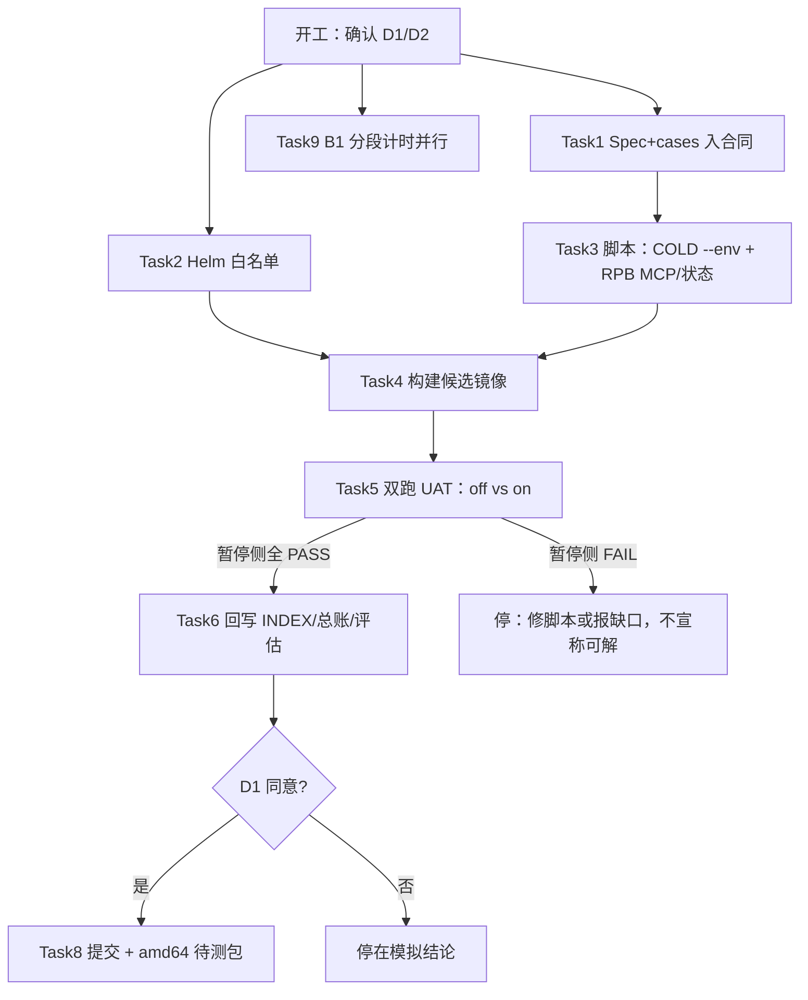

# P1-47 暂停交付接力：UAT 验证客户回滚根因可解

| 元数据 | 内容 |
|---|---|
| 文档名称 | P1-47 暂停交付接力：UAT 验证客户回滚根因可解 |
| 文档类型 | Plan |
| 版本 | v0.1 |
| 撰写日期 | 2026-11-18 |
| 撰写人 | Cursor（Claude） |
| 委托人 | xingchen |
| 基于材料 | [暂停交付与根治并行计划](lucy-20261118-p147-pause-delivery-and-root-fix-plan.md)；[升级放行评估](../reviews/2026-11-18-p145-p147-upgrade-readiness-assessment.md)；[暂停对照跑次](../qa/uat/suites/rebuild-probe-budget/runs/2026-11-18-cursor-rpb-p147-pause-control.md)；错题 [2026-11-17-k8s-upgrade-event-loop-readiness-timeout](../lessons/2026-11-17-k8s-upgrade-event-loop-readiness-timeout.md)；P1-39／45／46／47 Spec |
| 适用范围 | 接力执行父 Plan 的 **A0→A2（模拟 UAT 优先）**，用证据回答：「带暂停的候选是否能消除 11-17 客户回滚的同类根因」。不宣称客户现场已 PASS，不替代 C01–C20 正式出包 |
| 输出位置 | `docs/plans/lucy-20261118-p147-pause-uat-relay-plan.md` |
| 状态 | **v0.2；D1／D2 已确认；Task 1–6 已执行。** 模拟双跑结论＝**暂停可解 11-17 同形根因**；默认配置仍 FAIL。下一步 Task 8（提交＋amd64 待测包） |
| 授权边界 | **已执行**：A0／A1／A2／台账回写。**D1 已同意提交**（待本会话或后续落地 commit）。**仍未授权**：线上升级、正式客户包发出、B2 根治手段、把暂停 PASS 写成 P1-47 PASS |
| 验收 | 见 §验收 |
| 配对父 Plan | [lucy-20261118-p147-pause-delivery-and-root-fix-plan.md](lucy-20261118-p147-pause-delivery-and-root-fix-plan.md) |
| 总账条目 | P1-47／REQ-030-068（交付缓解）；证据亦覆盖 P1-39 回滚根因对照 |

> **For agentic workers:** 按 Task 顺序执行；每 Task 结束用 checkbox 勾选并回写跑次／INDEX。禁止跳过「对照＋暂停」双跑就写「可解回滚」。

**Goal:** 用 Docker 限速台上的正式 UAT 跑次，证明「客户包置 `LUCY_INFERRED_MAINTAINER=off`」能消除与 11-17 回滚同形的事件循环／readyz 停顿，并保持 MCP 主路径可用；同时把开关送进 Helm，使客户部署真能吃到该配置。

**Architecture:** 父 Plan 的 A／B 双线不变。本接力 Plan 把 **A2 模拟 UAT** 提为第一硬门：先补用例与脚本 → 构建候选镜像 → **同夹具双跑（默认开 vs off）** → 只在暂停侧全 PASS 时判定「回滚根因在模拟台上可解」。Helm 白名单与 Spec 入合同并行，避免「代码有开关、Chart 传不进 Pod」。B1 分段计时可与 A2 并行，不挡 UAT 结论。

**Tech Stack:** Docker 限速 UAT（`scripts/uat/rebuild-probe-budget.mjs`、`cold-start-slow-disk.mjs`）、Vitest、Helm Chart `deploy/k8s/helm/lucy/`、总账／INDEX／e2e-ledger。

## Global Constraints

- **模拟 UAT ≠ 客户现场 PASS**；跑次文案必须写「模拟」。
- **暂停 ≠ P1-47 修复**；默认配置（维护器开）下 P1-47 仍 FAIL，不得关 `GAP-UAT-P1-47`。
- **默认仍为开**；仅客户测试／待测实例 values 置 `off`，不改 demo 默认行为。
- 客户镜像出包须干净树 `linux/amd64`（C07／G1–G4）；本 Plan 的 A2 可用 arm64 dirty 候选，但结论须标注镜像指纹。
- 未获 D1 不得 `git commit`；未获线上升级授权不得动客户集群。
- 主路径可用性：暂停时问数／MCP／管理入口可用；审计页问询编号新鲜度可暂时让位（须在跑次与随包说明披露）。

---

## 目标

回答一个是／否问题（仅限模拟台）：

> 在与客户同形的满量审计库＋慢盘冷缓存夹具下，将推断问询后台补算暂停后，是否不再出现导致 11-17 回滚的 livez／readyz 秒级停顿，且 MCP 握手／工具调用仍可用？

| 客户 11-17 症状 | 本 Plan 对应验证 | 通过标准（模拟） |
|---|---|---|
| 升级后 livez 1.5–2.2s、event-loop p99≈2.2s | UAT-RPB-05（暂停）＋对照（不暂停） | 暂停：livez max ≤1000ms、p99 ≤400ms；≥1.5s 样本＝0。对照须仍 FAIL（证明根因未消失，只是被暂停关掉） |
| readyz 超 3s → Ready=False → 502／503 | UAT-RPB-05 的客户 3s 观察器；UAT-COLD-07／08 | 连续失败 &lt; 6；readyz p99 ≤1500ms；首次升级／重启能就绪 |
| MCP／入口不可用 | UAT-RPB-06 | `initialize`→`tools/list`→目录／Wiki（可行时 `lucy_query`）全成功；单次 p99 ≤3s |
| 状态误报「补算完成」 | UAT-RPB-07 | `inferredRebuild.paused=true` 且 `complete=false`；启动日志有暂停警告 |

**明确不在本 Plan 内宣称的东西：** 客户现网已可升级、P1-47 功能合同收口、正式客户包可发出。那些仍走父 Plan A4／A5／C01–C20。

## 开工前置

委托人确认下列两项后，本 Plan 视为可执行（回复「按建议执行」即可）：

| # | 决策 | 本 Plan 默认假设（建议） |
|---|---|---|
| D1 | 是否同意在 A2 模拟 UAT 全 PASS 后提交代码（干净树出 amd64 待测包的前提） | **同意**。提交范围＝P1-45／46／47＋暂停开关＋Helm 白名单＋UAT／文档 |
| D2 | 暂停如何进客户 Pod | **(a) Chart 白名单**：`_helpers.tpl` 增加 `LUCY_INFERRED_MAINTAINER`（空则不下发）；客户待测 values 置 `off`。解除暂停只改 values，不换镜像 |

**已具备（无需再确认）：** 暂停开关代码已在树内；对照实验已证明 off→livez 11ms／on→2662ms；父 Plan 方向已批准；A 线与 B1 分段计时已授权。

**当前缺口快照：**

| 缺口 | 现状 |
|---|---|
| Spec 暂停合同（SC-08–10） | P1-47 Spec 仍 v0.2，暂停只在状态行叙述 |
| Helm 白名单 | Chart **无** `LUCY_INFERRED_MAINTAINER`，客户 values 写了也不会进 Pod |
| cases.md | 尚无 RPB-05／06／07、COLD-07／08 |
| `cold-start-slow-disk.mjs --env` | **未支持**（RPB 已支持） |
| git 提交 | HEAD 已含暂停相关提交与文档；若本地另有 dirty，A3 前须干净 |

## 总览



---

### Task 1: Spec／用例入合同（父 Plan A0）

**Files:**
- Modify: `docs/specs/lucy-20261118-rebuild-probe-budget-spec.md`（升 v0.3：SC-08／09／10；状态行写「暂停≠修复」）
- Modify: `docs/qa/uat/suites/rebuild-probe-budget/cases.md`（增 RPB-05／06／07）
- Modify: `docs/qa/uat/suites/cold-start-slow-disk/cases.md`（增 COLD-07／08）
- Modify: `docs/qa/uat/INDEX.md`（新用例标 NOT RUN）
- Modify: `docs/plans/lucy-20261107-lucy-0-30-feature-inventory-pool.md`（变更行；**不**改 P1-47 跟进判定句为 PASS）
- Modify: `docs/governance/e2e-ledger.md`（登记用例挂接）

**Interfaces:**
- Consumes: 已实现的 `isInferredMaintainerPaused()`／`LUCY_INFERRED_MAINTAINER=off`
- Produces: 可被 Task 5 引用的正式用例 ID 与门槛表

- [ ] **Step 1:** 在 P1-47 Spec 增加 SC-08（默认开行为不变；`off` 不创建维护器；状态 `paused`）、SC-09（暂停配置下达到原 RPB-01 门槛）、SC-10（暂停下 MCP 主路径可用）。状态行明确：默认配置仍 FAIL。
- [ ] **Step 2:** `cases.md` 写入 RPB-05／06／07、COLD-07／08 步骤与期望（门槛抄父 Plan §5）。
- [ ] **Step 3:** INDEX 挂 NOT RUN；总账变更行记「用例已登记、未跑」。
- [ ] **Step 4:** `npm run lint:spec-docs`；`node scripts/uat/check-e2e-ledger.mjs` — 期望相关项无新增失败。

---

### Task 2: Helm 注入暂停开关（父 Plan A1）

**Files:**
- Modify: `deploy/k8s/helm/lucy/templates/_helpers.tpl`（在 `lucy.env` 段、`LUCY_CONTENT_ROOT` 旁增加空则不下发的 `LUCY_INFERRED_MAINTAINER`）
- Modify: `deploy/k8s/helm/lucy/values.yaml`（`env.LUCY_INFERRED_MAINTAINER: ""`）
- Modify: `deploy/k8s/helm/lucy/examples/values.customer.example.yaml`（注释说明：待测／缓解期可设 `off`）
- Modify: `deploy/k8s/helm/lucy/Chart.yaml`（内容变更 → Chart `version` 递增，**不**改 `appVersion`）
- Verify: `npm run gate:k8s-static`；`helm template` 空／`off` 两态

**Interfaces:**
- Consumes: 运行时已识别的 env 名 `LUCY_INFERRED_MAINTAINER`
- Produces: 客户实例可通过 values 把 `off` 注入 Pod

- [ ] **Step 1:** `_helpers.tpl` 增加：

```yaml
{{ if .Values.env.LUCY_INFERRED_MAINTAINER -}}
- name: LUCY_INFERRED_MAINTAINER
  value: {{ .Values.env.LUCY_INFERRED_MAINTAINER | quote }}
{{ end -}}
```

- [ ] **Step 2:** `values.yaml` 默认 `""`；example 文件加注释（默认空＝维护器开）。
- [ ] **Step 3:** Chart version `0.2.9` → `0.2.10`（若落地时已更高则 +0.0.1）。
- [ ] **Step 4:** 渲染验证：

```bash
helm template lucy deploy/k8s/helm/lucy \
  --set env.LUCY_PUBLIC_MCP_URL=https://example.com/mcp \
  | grep -c LUCY_INFERRED_MAINTAINER
# 期望：0（默认空不下发）

helm template lucy deploy/k8s/helm/lucy \
  --set env.LUCY_PUBLIC_MCP_URL=https://example.com/mcp \
  --set env.LUCY_INFERRED_MAINTAINER=off \
  | grep -A1 'name: LUCY_INFERRED_MAINTAINER'
# 期望：value: "off"
```

- [ ] **Step 5:** `npm run gate:k8s-static` — 期望 PASS。

---

### Task 3: UAT 脚本补齐（父 Plan A2 前置）

**Files:**
- Modify: `scripts/uat/cold-start-slow-disk.mjs`（解析 `--env KEY=VAL`，只作用于被测限速容器，对齐 RPB）
- Modify: `scripts/uat/rebuild-probe-budget.mjs`（增：MCP 循环探针；`inferredRebuild` 状态断言；子命令或 flag 跑 RPB-06／07）
- Modify: `webui/server/__tests__/inferred-maintainer-pause-switch.test.ts`（若 Helm／状态字段有新契约则补守卫；否则跳过）

**Interfaces:**
- Consumes: Task 1 用例 ID；已有 RPB `--env`
- Produces: 可一键跑暂停版 COLD／RPB 的命令行

- [ ] **Step 1:** 为 `cold-start-slow-disk.mjs` 增加与 RPB 相同的 `EXTRA_ENV` 解析，并在 `docker run` 被测容器时 `-e KEY=VAL`。
- [ ] **Step 2:** RPB 增加 MCP 循环（每 10s：`initialize`→`tools/list`→一次轻量工具）与 status JSON 检查（`paused===true && complete===false`）。
- [ ] **Step 3:** usage 字符串更新；本地 `--help`／干跑确认参数解析。
- [ ] **Step 4:** 相关 vitest：`npx vitest run webui/server/__tests__/inferred-maintainer-pause-switch.test.ts` — 期望 PASS。

---

### Task 4: 构建候选镜像

**Files:** 无文档必改；产物为本地 Docker 镜像标签。

- [ ] **Step 1:** 平滑升级构建（保留 volume，除非要 fresh）：

```bash
BUILDPLATFORM=linux/arm64 npm run demo:upgrade
# 或显式：docker compose -f deploy/compose/docker-compose.demo.yml build --build-arg BUILDPLATFORM=linux/arm64 lucy
```

- [ ] **Step 2:** 打标签便于跑次引用，例如 `project-lucy:p147-pause-uat`（记录 `git rev-parse HEAD` 与是否 dirty）。
- [ ] **Step 3:** 记下 WebUI／MCP 映射端口（demo 默认 `http://127.0.0.1:55176`／`57881`，以当次为准）。

---

### Task 5: 双跑模拟 UAT（本 Plan 核心）

**Files:**
- Create: `docs/qa/uat/suites/rebuild-probe-budget/runs/2026-11-18-cursor-rpb-pause-uat.md`（或当日日期）
- Create: `docs/qa/uat/suites/cold-start-slow-disk/runs/2026-11-18-cursor-cold-pause-uat.md`
- Evidence: `docs/qa/uat/suites/*/runs/evidence/...`（脚本产出可先落 `inbox/`，再归档必要 JSON）

**判定规则（硬）：**

1. **暂停侧（`--env LUCY_INFERRED_MAINTAINER=off`）** 必须：RPB-05／06／07 PASS；COLD-07／08 PASS（门槛见父 Plan §5／P1-39 放宽首次升级门槛）。
2. **对照侧（不设 env）** 必须在同一镜像、同一夹具下 **RPB-01 或等价满量窗仍 FAIL**（livez 秒级），证明「不是夹具变松，而是暂停关掉了根因」。
3. 任一条暂停侧 FAIL → **不得**写「可解客户回滚」；只写缺口与下一步。

- [ ] **Step 1 — 对照（维护器开）:**

```bash
node scripts/uat/rebuild-probe-budget.mjs all \
  --image project-lucy:p147-pause-uat \
  --label 2026-11-18-pause-uat-on \
  --premigrate-wait-s 60
```

期望：RPB-01 livez max 仍 ≫ 1000ms（与既有 2662–2968ms 同形）→ 记 FAIL。

- [ ] **Step 2 — 暂停满量窗:**

```bash
node scripts/uat/rebuild-probe-budget.mjs all \
  --image project-lucy:p147-pause-uat \
  --label 2026-11-18-pause-uat-off \
  --premigrate-wait-s 60 \
  --env LUCY_INFERRED_MAINTAINER=off
```

期望：RPB-05 门槛达标；跑次中完成 06／07 或紧随专用子命令。

- [ ] **Step 3 — 暂停冷启动升级／重启:**

```bash
node scripts/uat/cold-start-slow-disk.mjs all \
  --new-image project-lucy:p147-pause-uat \
  --label 2026-11-18-cold-pause-off \
  --env LUCY_INFERRED_MAINTAINER=off
```

期望：COLD-07／08（及既有 R0／01–05 在暂停配置下无回归）按门槛 PASS。

- [ ] **Step 4:** 写跑次 Markdown：镜像指纹、dirty 否、限速参数、样本摘要、对照表、**结论句只用「模拟台上回滚根因可解／不可解」**。

---

### Task 6: 台账回写与放行评估修订

**Files:**
- Modify: `docs/qa/uat/INDEX.md`
- Modify: `docs/plans/lucy-20261107-lucy-0-30-feature-inventory-pool.md`
- Modify: `docs/governance/e2e-ledger.md`
- Modify: `docs/reviews/2026-11-18-p145-p147-upgrade-readiness-assessment.md`（追加一节：暂停交付模拟结论）
- Modify: `docs/plans/lucy-20261118-p147-pause-delivery-and-root-fix-plan.md`（勾选 A0–A2 进度）

- [ ] **Step 1:** INDEX：暂停配置用例写模拟 PASS／FAIL；**P1-47 套件总判定仍为 FAIL（默认配置）**。
- [ ] **Step 2:** 总账变更行：记录双跑证据；跟进状态句保持「默认 FAIL；暂停为交付缓解」。
- [ ] **Step 3:** 评估文档：若 Task 5 暂停侧全 PASS＋对照 FAIL → 结论升级为「**模拟台证明暂停可解 11-17 同形根因；仍不放行生产，可进 amd64 待测包前置验证**」。若失败 → 维持不放行并列出缺口。

---

### Task 7:（可选并行）B1 分段计时

**Files:**
- Modify: `webui/server/proxy/audit.ts` 与／或 `inferred-turn-maintainer.ts`（`LUCY_REBUILD_TRACE=1` 门控日志）
- Create: `inbox/` 或 `docs/reviews/` 下一份分段占比报告（过程性可先 inbox）

- [ ] **Step 1:** 仅加门控日志，不改重建语义。
- [ ] **Step 2:** **不暂停**复跑 RPB-01，输出写片／提交／WAL／读页占比。
- [ ] **Step 3:** 报告呈委托人，供日后 D3（B2 手段）决策——**不挡** Task 5／6 的暂停结论。

---

### Task 8: 提交与 amd64 待测包（仅当 D1＝同意且 Task 5／6 通过）

**Files:** 干净提交；构建脚本按 runbook。

- [ ] **Step 1:** 委托人明示后提交（范围见开工前置 D1）；`git status` 无 dirty。
- [ ] **Step 2:** `bash scripts/release/build-customer-amd64-image.sh`（或现行客户 amd64 入口），标签 `*-test`；过 G1–G4d、G8；`BUILD_REVISION`＝提交且无 `-dirty`。
- [ ] **Step 3:** 交付委托人 A4 清单：实例 values 必须含 `env.LUCY_INFERRED_MAINTAINER: off`；备份／回滚演练；升级窗 readyz／livez 序列；真实 MCP 问数。

**本 Task 不做：** 正式客户包 C01–C20 发出、客户侧解除暂停（父 Plan A5／B5）。

---

## 风险

| 风险 | 处理 |
|---|---|
| 把暂停 PASS 写成 P1-47 PASS | INDEX／总账／评估强制双行：默认 FAIL + 暂停缓解 PASS |
| Chart 未注入导致「以为暂停了」 | Task 2 必须先于正式待测包；A4 checklist 核 `kubectl exec` 环境变量 |
| arm64 dirty 模拟 PASS ≠ amd64 客户 | Task 5 结论限「模拟」；D1 后走 Task 8 |
| COLD 脚本无 `--env` 导致假阴性／假阳性 | Task 3 阻塞 Task 5 Step 3 |
| 暂停期审计编号不更新被当成缺陷 | 跑次与随包说明披露；RPB-07 证明状态诚实 |
| B1 并行抢带宽 | B1 不挡 A2；RPB 机时优先给 Task 5 |

## 验收

- Task 5：暂停侧 RPB-05／06／07 + COLD-07／08 全部**模拟 PASS**；对照侧满量窗仍 **FAIL**。
- Task 2：`helm template` 空／off 两态正确；`gate:k8s-static` PASS。
- Task 6：INDEX／总账／评估／e2e-ledger 同句；评估给出「模拟可解／不可解」明确句。
- **不得**仅凭本 Plan 宣称可上线或客户现场已验证。

## 完成定义

- **本接力 Plan 完成**＝模拟双跑结论已落盘，且 Helm 能下发暂停开关；委托人拿到「是否可解 11-17 同形根因」的是／否答案（模拟台）。
- **父 Plan 完成**仍要求 A4 原生升级演练、A5 正式包、B 线根治与解除暂停——不在本文件完成定义内。

## 估时（粗估）

| 项 | 估时 |
|---|---|
| Task 1–3 | 2–4 小时 |
| Task 4–5（含双跑墙钟） | 3–6 小时（限速台） |
| Task 6 | 1 小时 |
| Task 7 B1 | 1–2 小时（并行） |
| Task 8 | 1–2 小时构建 + 等委托人 A4 |
