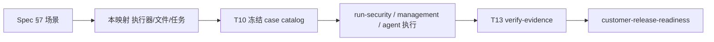

# Lucy 企业安全整改与真实用户 E2E 验收映射

| 元数据 | 内容 |
|---|---|
| 文档名称 | Lucy 企业安全整改与真实用户 E2E 验收映射 |
| 文档类型 | Checklist |
| 版本 | v1.0 |
| 撰写日期 | 2026-10-18 |
| 撰写人 | Claude（Cursor Builder，T00） |
| 委托人 | xingchen |
| 基于材料 | [Spec v0.2](../specs/lucy-20261018-enterprise-security-and-real-e2e-spec.md) §6～§8；[Plan v0.2](../plans/2026-10-18-enterprise-security-and-real-e2e-plan.md) T00～T15；[安全缺陷登记](security-findings.yaml)；评估 v1.1 与本次 T00 基线（runId `t00-20261018-0042`） |
| 适用范围 | 为 Spec §7 的 32 个场景及显式子场景分配「执行器 / 计划落地的测试文件 / 任务 ID」；T10 冻结正式 case catalog 前的唯一映射来源 |
| 输出位置 | `docs/qa/enterprise-security-real-e2e-acceptance.md` |

## 0. 使用约定

- **不复制授权规则正文**：断言以 Spec 对应章节为准，本表只登记归属。场景 ID 沿用 Spec §7；子场景 ID 为 **T00 临时编号**，T10 写入 `scripts/e2e/contracts/case-catalog.yaml` 时可改名，但不得合并或丢失。
- 执行器沿用 Spec §7：B=真实浏览器；P=直接协议/HTTP；D=真实 DB；A=真实 Agent 产品客户端；O=运维/故障；V=证据校验器。每行至少一个执行器；无执行器的 required 场景视为本文件未完成。
- 「落地文件」列：**既有** = 仓库当前已存在，复用并按任务补强；**新建** = Plan 计划新建，当前尚不存在。路径均为 Plan 原文，未在 T00 创建。
- 单元/模拟 UI（contract 层）不能签用户 E2E；每个 required 变体最终都要有 security-integration 或 user-e2e 层的真实执行。
- 本文件不是通过证据。只有 `scripts/e2e/verify-evidence.mjs`（T13）对完整 release execution 的校验结果才有效。

- 场景 → 映射（T00）→ 冻结目录（T10）→ 三类执行 → 唯一 verifier → 客户上线门禁。

## 1. Spec §7 的 32 个主场景

任务 ID 含义见 Plan §3；`T0A` 为 A0 热修复。通用落地文件缩写：

- `RS` = `scripts/e2e/run-security.mjs`（新建，T10）。
- `RA` = `scripts/e2e/run-agent-journey.mjs`（新建，T12）。
- `RB-*` = `webui/tests/real-e2e/*.spec.ts`（新建，T11）。
- `VF` = `scripts/e2e/verify-evidence.mjs`（新建，T13）。
- `WS` = `webui/server/__tests__/`。

| ID | 场景 | 执行器 | 计划落地的测试文件 / 执行入口 | 任务 ID | 复用既有资产 |
|---|---|---|---|---|---|
| SEC-01 | 默认管理认证 | B/P/O | 新建 `WS/webui-deployment-mode.test.ts`、改 `WS/webui-admin-auth.test.ts`；`RS`；`RB-admin-auth`；`scripts/runtime/docker-entrypoint.test.mjs`；`gate:k8s-static` | T0A-2、T02、T10、T11、T14 | 既有 `WS/webui-admin-auth.test.ts`、`scripts/runtime/docker-entrypoint.test.mjs` |
| SEC-02 | 引导密钥与并发 | B/P | 新建 `WS/webui-bootstrap-concurrency.test.ts`；`RS`；`RB-admin-auth` | T0A-2、T02、T10、T11 | 既有 `WS/webui-admin-auth.test.ts` |
| SEC-03 | 管理职责（owner/operator） | B/P | 改 `WS/webui-admin-auth.test.ts`；新建 `WS/audit-actor-propagation.test.ts`；`RS`；`RB-admin-auth` | T02、T08、T10、T11 | 既有 `WS/webui-admin-auth.test.ts` |
| SEC-04 | 会话回收 | B/P/O | 新建 `WS/webui-session-revocation.test.ts`、`WS/webui-account-incarnation.test.ts`；`RS`；`RB-admin-auth`；恢复 runbook 演练（T03）+ OPS-01 | T03、T10、T11、T14 | 既有 `WS/webui-admin-auth.test.ts` |
| SEC-05 | 认证失败/限速 | P/O | 新建 `WS/webui-auth-rate-limit.test.ts`、`WS/audit-actor-propagation.test.ts`；`RS`（含重启不清桶） | T02、T08、T10 | 既有 `WS/web-security.test.ts` |
| SEC-06 | Token 一次性展示 | B/P/V | `RB-management-journey` + `webui/tests/real-e2e/helpers/secret-capture.ts`；新建 `WS/audit-secret-scrub.test.ts`；`RS` 泄漏扫描；`VF` artifact 扫描 | T08、T10、T11、T13 | 既有 `WS/admin-tokens.test.ts`、`WS/proxy-identity-device.test.ts` |
| SEC-07 | 过期/吊销/停用后所有通道 | B/P/A | 新建 `WS/mcp-disabled-agent-all-methods.test.ts`、`WS/mcp-admission-all-methods.test.ts`、`WS/mcp-revocation-stream.test.ts`；`RS`；`RB-management-journey`；`RA` | T0A-3、T04、T10、T11、T12 | 既有 `WS/mcp-proxy-skills.test.ts`、`WS/mcp-proxy-acl.test.ts` |
| SEC-08 | 错误身份（匿名/假 Token/Cookie/外来 sessionId/batch） | P | 新建 `WS/mcp-admission-all-methods.test.ts`、`WS/mcp-session-ownership.test.ts`；`RS` | T04、T10 | 既有 `WS/mcp-proxy-upstream-session.test.ts`、`WS/mcp-proxy-acl.test.ts` |
| SEC-09 | 连接/表/同名 source | P/D/A | `RS`（同名 source 夹具）；`RA`；子场景见 §2 | T10、T12 | 既有 `WS/mcp-proxy-acl.test.ts`、`WS/ac-security-eval.test.ts`、`WS/ambiguous-source-hint.test.ts` |
| SEC-10 | Role Set（同角色闭合/OR/AND） | P/D | `RS`；改 `WS/ac-security-eval.test.ts`；`WS/context-acl-matrix.test.ts`（上下文通道侧，T05 新建） | T05、T10 | 既有 `WS/ac-security-eval.test.ts`、`WS/agent-constraints-ac-p15.test.ts`、`WS/admin-roles.test.ts` |
| SEC-11 | 真行集（BY-01～19） | P/D | `RS` + 真 KTX/DB gold（`examples/security-e2e/gold/compute-gold.mjs`，T10 新建） | T10 | 既有 `WS/mcp-proxy-row-policy-by01-by18.test.ts`、`WS/row-policy-ac-p1.test.ts`、`scripts/smoke/ac-p1-ktx-forced-filters-probe.sh`、`scripts/smoke/ac-p15-uat-runbook.mjs` |
| SEC-12 | 绕过输入 | P/D | `RS`（绕过语料、上游执行计数为 0）；子场景见 §2 | T10 | 既有 `WS/query-guardrails.test.ts`、`WS/mcp-proxy-row-policy-by01-by18.test.ts` |
| SEC-13 | 策略/启用表变化 | B/P/O | 新建 `WS/context-policy-invalidation.test.ts`、`WS/mcp-revocation-stream.test.ts`；`RS`；`RB-management-journey` | T04、T05、T10、T11 | 既有 `WS/role-permission-draft-parity.test.ts` |
| SEC-14 | 上下文隔离 | B/P/A | 新建 `WS/context-acl-matrix.test.ts`、`WS/context-channel-parity.test.ts`、`WS/context-acl-migration.test.ts`；`RB-context-isolation`；`RS`；`RA` | T05、T06、T10、T11、T12 | 既有 `WS/skill-acl.test.ts`、`WS/mcp-proxy-skills.test.ts`、`WS/mcp-proxy-instructions.test.ts`、`webui/tests/e2e/specs/business-skill-151.spec.ts`（contract 层） |
| SEC-15 | 文件内容供应链 | P/O/B | 新建 `WS/frontmatter-safety.test.ts`、`WS/context-file-boundary.test.ts`；`RS`；`RB-context-isolation`；FM 子场景见 §3 | T0A-1、T06、T10、T11 | 既有 `WS/wiki.test.ts`、`WS/api.semantic-asset-export.test.ts` |
| SEC-16 | 间接提示注入 | A/P/D | `RA`（Wiki/Skill/单元格注入）；`RS`；受控出站 sink（T10 环境） | T10、T12 | — |
| SEC-17 | 全载体泄漏 | V/P | `RS` 全载体扫描；`VF`；新建 `WS/audit-secret-scrub.test.ts` | T08、T10、T13 | 既有 `WS/audit-privacy.test.ts` |
| SEC-18 | 可问责审计 | B/P/V | 新建 `WS/audit-actor-propagation.test.ts`、`WS/audit-release-barrier.test.ts`；`RB-audit-export`；`collect-server-evidence.mjs`；`VF` | T07、T08、T11、T12、T13 | 既有 `WS/admin-audit.test.ts`、`WS/mcp-proxy-audit-meta.test.ts`、`WS/request-client-meta.test.ts` |
| SEC-19 | 审计故障 | O/P | 新建 `WS/audit-release-barrier.test.ts`、`WS/audit-projection-recovery.test.ts`；`RS` 故障变体（隔离控制面） | T07、T10 | 既有 `WS/audit-write-health.test.ts`、`WS/proxy-audit.test.ts` |
| SEC-20 | 导出/保留/历史 | B/P/O/V | 新建 `WS/audit-secret-scrub.test.ts`；改 `WS/audit-export-paging.test.ts`；`RB-audit-export`；`VF` | T08、T11、T13 | 既有 `WS/audit-export-paging.test.ts`、`WS/audit-privacy.test.ts`、`WS/query-artifact-cold-store.test.ts` |
| SEC-21 | 会话跨 Token/客户端 | P/A | 新建 `WS/mcp-session-ownership.test.ts`；`RS`；`RA` | T04、T10、T12 | 既有 `WS/mcp-proxy-upstream-session.test.ts` |
| SEC-22 | 客户网络（TLS/Origin/可信代理/旁路） | O/P/B | `WS/web-security.test.ts`（改）；`gate:k8s-static`；`RS`；`RB-admin-auth`；`deploy/k8s/security-e2e/` | T02、T10、T11、T14 | 既有 `WS/web-security.test.ts`、`scripts/gates/helm-lucy-gate.sh` |
| SEC-23 | 依赖与交付 | O/V | `npm --prefix webui audit --omit=dev`；`docs/qa/security-findings.yaml` 交叉校验；G1–G4 ELF/架构 gate；`VF` | T09、T13、T14 | 既有 `scripts/gates/g8-image-k8s-contract-gate.sh`、`scripts/release/security-baseline.mjs` |
| UX-01 | J-01 管理到使用 | B/A/D | `RB-management-journey`；`RA`；`RS` 同实例核对 | T11、T12 | 既有 `docs/qa/suite-user-journey.md`（UJ-ADM-01、UJ-ENG-01）、`webui/tests/e2e/specs/e2e-pub-01.spec.ts`（contract 层） |
| UX-02 | 业务正确性 | A/D | `RA`；`scripts/e2e/answer-assertions.mjs`；独立 gold 计算器 | T10、T12 | 既有 `scripts/smoke/p1-agent-e2e.mjs`（T09 先修门禁语义） |
| UX-03 | 空/NULL/0/失败 | A/D/O | `RA`；故障/超时变体；子场景见 §2 | T12 | 既有 `WS/question-budget.test.ts`、`WS/query-guardrails.test.ts` |
| UX-04 | 多轮/发布与恢复 | B/A/D | `RB-management-journey`；`RA`；子场景见 §2 | T11、T12 | 既有 `WS/report-template-pilot.test.ts`、`WS/certified-route.test.ts` |
| UX-05 | 多产品一致性（每 required 产品 3 次） | A/V | `RA` + 各产品 adapter；`VF`（3 次不可删除） | T12、T13 | — |
| UX-06 | 离线 Eval | B/P/D | `RB-eval-offline`；`RS` hash/完整性拒绝变体 | T10、T11 | 既有 `WS/eval-offline-batch.test.ts`、`WS/eval-offline-runner.test.ts`、`WS/eval-results-import.test.ts`、`WS/eval-suite-import.test.ts` |
| UX-07 | 现场提问/安全候选 | B/P | `RB-eval-offline` / `RB-audit-export`；`RS` | T10、T11 | 既有 `WS/eval-field-questions.test.ts` |
| OPS-01 | amd64 K8s 新装/升级/恢复 | O/B/P/A | `scripts/gates/k8s-{acceptance,release-gate,upgrade-gate}.sh`；`RS`/`RB-*`/`RA` 在同一候选 digest 上执行 | T14 | 既有 `scripts/gates/k8s-gate-negative.test.mjs`、`scripts/gates/helm-lucy-gate.sh` |
| GATE-01 | 门禁反向测试 | V | 新建 `scripts/e2e/__tests__/evidence-verifier.test.mjs`、`scripts/gates/customer-release-readiness.test.mjs`；改 `scripts/gates/p1-release-readiness.test.mjs` | T09、T13 | 既有 `scripts/gates/p1-release-readiness.test.mjs`、`scripts/smoke/p1-agent-e2e.test.mjs` |

统计：SEC 23 行 + UX 7 行 + OPS 1 行 + GATE 1 行 = **32 行**，每行至少一个执行器。

## 2. Spec §7 显式子场景（T00 临时编号）

| 子场景 ID | 来源（Spec §7） | 子场景 | 执行器 | 计划落地文件 | 任务 ID |
|---|---|---|---|---|---|
| SEC-09-S01 | SEC-09/12 | `discover_data` 拒绝建议只含授权对象 | P/D/A | `RS`；`RA` | T10、T12 |
| SEC-09-S02 | SEC-09/12 | `dictionary_search` 同上 | P/D/A | `RS`；`RA` | T10、T12 |
| SEC-09-S03 | SEC-09/12 | `entity_details` 同上 | P/D/A | `RS`；`RA` | T10、T12 |
| SEC-09-S04 | SEC-09/12 | 物理表别名与歧义修复提示同上 | P/D | `RS`；既有 `WS/ambiguous-source-hint.test.ts` | T10 |
| SEC-09-S05 | SEC-09/12 | 未知 tool AbsoluteDeny | P | `RS`；既有 `WS/mcp-proxy-acl.test.ts` | T10 |
| UX-02-S01 | UX-02/04 | 内建度量 `count(*)`/`count(1)` 引导、嵌套聚合拒绝、同名字段消歧、中文度量 | A/D | `RA`；`answer-assertions.mjs`；既有 `WS/query-guardrails.test.ts` | T12 |
| UX-04-S01 | UX-02/04 | 认证路径与报告模板沿用原查询 ACL、不扩大来源 | P/A | `RS`；`RA`；既有 `WS/certified-route.test.ts`、`WS/report-template-pilot.test.ts` | T10、T12 |
| UX-04-S02 | UX-02/04 | 模板/口径/实际预测版本与审计 appliedVersion 一致；模板错误/权限拒绝不静默改题 | A/D | `RA`；`collect-server-evidence.mjs` | T12 |
| UX-03-S01 | UX-03 | 问询预算耗尽、一次继续、无绕过无限循环（阈值沿用 Spec 162） | A/P | `RA`；既有 `WS/question-budget.test.ts` | T12 |
| UX-03-S02 | UX-03 | 查询并发上限、失败后释放执行槽、合法后续请求继续 | P/A | `RS`；`RA` | T10、T12 |
| UX-03-S03 | UX-03 | 取消、超时重试、空结果与慢调用 | A/O | `RA`；故障/超时变体 | T12 |
| SEC-18-S01 | SEC-18/20、UX-07 | 「先调用后上报问题」补绑 | P/V | `RS`；既有 `WS/turn-correlation.test.ts` | T08、T10、T13 |
| SEC-18-S02 | SEC-18/20、UX-07 | 不同客户端/会话不并簇 | P/A | `RS`；`RA`；既有 `WS/turn-correlation.test.ts` | T10、T12 |
| SEC-18-S03 | SEC-18/20、UX-07 | 一次原始问询不重复生成为推断问询 | P/V | `RS`；`RB-audit-export` | T10、T11 |
| SEC-18-S04 | SEC-18/20、UX-07 | 初始化/发现探测不虚增业务问询 | P/V | `RS`；`RB-audit-export` | T10、T11 |
| UX-07-S01 | SEC-18/20、UX-07 | 调用监控/使用概况窗口、慢标记、eval 排除与真实事件对账 | B/P/V | `RB-audit-export`；既有 `WS/call-monitor.test.ts`、`WS/usage-default-view.test.ts`、`WS/usage-slow-call-list.test.ts`、`WS/admin-ui-usage.test.ts` | T11 |
| SEC-15-S01 | SEC-15/17/22 | 品牌图片/Markdown 脚本载荷不执行（含 allow 对照） | P/B | `RS`；`RB-context-isolation`；既有 `WS/branding.test.ts` | T10、T11 |
| SEC-22-S01 | SEC-15/17/22 | 管理快照、Skill 客户端导出与下载链接的权限/过期（含 allow 对照） | P/B | `RS`；`RB-audit-export`；既有 `WS/api.semantic-asset-export.test.ts` | T06、T10、T11 |
| SEC-22-S02 | SEC-15/17/22 | 部署许可 inactive/expired/invalid 在全部 MCP 内容通道（tools/resources/prompts/Wiki/initialize）一致 | P/O | `RS`；既有 `WS/license.test.ts` | T04、T10 |

## 3. SEC-15 的 frontmatter 子场景（Spec §4.6 / §7）

载荷集合：`---js`、`---javascript`、`---JS`、`--- js`、`---json`。断言：服务端零执行、明确 4xx、无写盘；合法 YAML 对照必须成功。

| 子场景 ID | 入口 | 执行器 | 计划落地文件 | 任务 ID |
|---|---|---|---|---|
| SEC-15-FM-01 | 上传预览 `POST /api/wiki/upload/preview` | P | 新建 `WS/frontmatter-safety.test.ts`；`RS` | T0A-1、T10 |
| SEC-15-FM-02 | 上传提交 `POST /api/wiki/upload/commit` | P | 同上 | T0A-1、T10 |
| SEC-15-FM-03 | 编辑保存 `PUT /api/wiki/:key`（dryRun 与非 dryRun） | P | 同上 | T0A-1、T10 |
| SEC-15-FM-04 | 读取磁盘已有文件 `GET /api/wiki/:key`（422） | P | 同上 | T0A-1、T10 |
| SEC-15-FM-05 | 版本恢复 | P | 同上 | T0A-1、T10 |
| SEC-15-FM-06 | 配置包导入 | P | 同上；`RS` | T0A-1、T10 |
| SEC-15-FM-SEED | 播种（Spec §4.6 第 4 条）：模板 Wiki 非法 frontmatter 时 entrypoint 失败并给出文件名 | O | `scripts/runtime/docker-entrypoint.test.mjs`（既有，补强） | T0A-1 |

`SEC-15-FM-SEED` 为 T00 补充登记，Spec §7 未单独编号；T10 case catalog 需确认其是否独立编号。

## 4. 原评估待写用户旅程的归属（不得留占位）

来源：`docs/qa/suite-user-journey.md` §3 矩阵中标「待写」的 10 条。

| 旅程 | 名称 | 归属场景 | 执行器 | 落地文件 | 任务 ID |
|---|---|---|---|---|---|
| UJ-ENG-02 | 连接概览巡检 + 刷新本地目录 | UX-01 | B | `RB-management-journey` | T11 |
| UJ-ENG-03 | 添加 Schema 抽屉 | UX-01 | B | `RB-management-journey` | T11 |
| UJ-ENG-04 | 上传 Manifest；覆盖确认 | UX-01 | B | `RB-management-journey` | T11 |
| UJ-ENG-05 | 维护启用表范围 | UX-01、SEC-13 | B/P | `RB-management-journey` | T11 |
| UJ-ENG-06 | 表目录 → 语义 → 保存并校验 | UX-01、UX-04 | B/A | `RB-management-journey` | T11 |
| UJ-ENG-07 | Wiki 阅读/编辑/保存预检/`sl_ref` | SEC-14、SEC-15 | B | `RB-context-isolation` | T11 |
| UJ-ADM-02 | 角色权限预览 | SEC-10、SEC-14 | B | `RB-context-isolation` | T11 |
| UJ-ADM-03 | 访问日志：问询与调用流水 | SEC-18、SEC-20 | B | `RB-audit-export` | T11 |
| UJ-ADM-04 | MCP 调试台受控 `tools/list` | SEC-08、SEC-14 | B/P | `RB-management-journey` | T11 |
| UJ-ADM-05 | 撤销 Token / 停用 Agent | SEC-07 | B/P/A | `RB-management-journey`；`RS`；`RA` | T11 |

## 5. 首发 required 客户端（Plan T00 步骤 4，R4/R7）

锁定值来自 Spec §10 默认决策，尚未在 `docs/qa/real-e2e-clients.yaml` 落盘（T10 新建）。

| 产品 | 接入方式 | 证据 transport | 状态 | adapter / 任务 |
|---|---|---|---|---|
| Codex | CLI + 从 WebUI 复制的 MCP 配置 | `cli` | required | `scripts/e2e/adapters/codex.mjs`，T12 |
| Cursor | CLI Agent（`cursor-agent` / `agent`，以 runner 实际安装为准）+ 同上配置 | `cli` | required | `scripts/e2e/adapters/cursor.mjs`，T12 |
| Cursor IDE GUI | GUI 自动化 | `gui` | optional，不进首发分母 | 未列入 |
| Hermes 两个 profile | — | — | **只计一个产品**，不能替代上述两个 | 不适用 |

当前开发机未检测到 Cursor CLI Agent 二进制（Plan T12 已声明），R8 runner 就绪前 T12 真实执行为 BLOCKED。其他已对外承诺支持的产品须在对应 release profile 中追加为 required。

## 6. T09 待办：selector 契约漂移（T00 只记录，未修）

命令 `npm --prefix webui run e2e:selector-contract` 于 2026-10-18 在 `lucy-v2.0` 工作区（HEAD `fbed6d4`）退出码 1，**33 项失败**，另 49 条 ORPHAN 警告。原样输出：`inbox/e2e/t00-20261018-0042/selector-contract.out`（临时目录，随时可删）。

| 类别 | 数量 | 涉及对象 |
|---|---|---|
| `UNREGISTERED`（实现存在、契约未登记） | 17 | `catalog-bound-scope-note`、`prepare-structure-drawer`、`endpoint-gate-{panel,back,different-database,retry-live,add-schema,separate}`、`setup-assistant-progress`、`agent-token-list`、`audit-turn-meta-card`、`audit-export-inquiry-pack`、`usage-call-monitor-link`、`execution-runtime-notice`、`whitelist-large-list-notice`、`monitor-field-panel`、`call-monitor-usage-slow-mark` |
| `UNREGISTERED TEMPLATE`（模板化 testid 未登记） | 13 | `${idPrefix}-{done,downgrade-preview,structure-error}`、`${testId}-{copy,download}`、`agent-token-row-${token.label}`、`audit-call-inferred-turn-id-${entry.id}`、`audit-usage-slow-${entry.id}`、`connection-more-${conn.id}`、`endpoint-gate-match-${match.id}`、`read-structure-${conn.id}-${schema}`、`schema-more-${conn.id}-${schema}`、`whitelist-group-toggle-${conn.id}-${schema}` |
| `SPEC-DANGLES-IMPL`（spec 引用的 testid 实现已无） | 3 | `skill-role-none`（`business-skill-151.spec.ts`）、`workbench-pending-count`（`e2e-pub-01.spec.ts`）、`role-permission-structure.spec.ts` 中的 `role-skill-access-summary` |

处置要求（Plan T09 步骤 4）：修真实漂移与正负引用识别，不降级为警告，不靠空元素断言或删失败用例制造绿灯。T06 会再改 selector 契约，两者在 T09 汇总复验。

另有同类待办一并挂 T09：`scripts/smoke/p1-governance-smoke.mjs` / `p1-publish-regression-smoke.mjs` 全 blocked 仍 exit 0；`p1-release-readiness.mjs` 把 dry-run 计为 passed；`scripts/smoke/p1-agent-e2e.mjs` 旧路径与 Role Set；`docs/qa/impact-map.json` 仍为旧版（G-02/03/04）。

## 7. 本映射的完整性检查

- [x] Spec §7 32 个主场景全部登记，每行有执行器与任务 ID（§1）。
- [x] Spec §7 明列的五组显式子场景全部登记（§2）。
- [x] `SEC-15-FM-01～06` 全部登记（§3）。
- [x] 原评估 10 条待写旅程均有归属（§4）。
- [x] 至少两个不同 required 产品（Codex + Cursor），Hermes 不重复计数（§5）。
- [ ] T10 冻结 case catalog 分母、变体展开（身份 × 协议 × 引擎 × 客户端）：**未完成，属 T10**。
- [ ] 各「计划新建」文件落地：**未完成，按 Plan 由各任务创建**。

## Terminology Compliance

本文件遵循 `webui/docs/00-product-terminology-standard.md`，未新增产品概念；「持久安全账本」「真实用户 E2E 上线门禁」「一次性引导密钥」等用语沿用 Spec「Terminology Compliance」登记。
