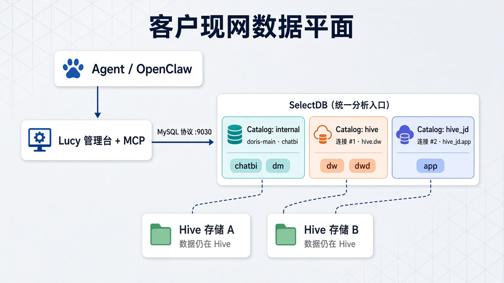
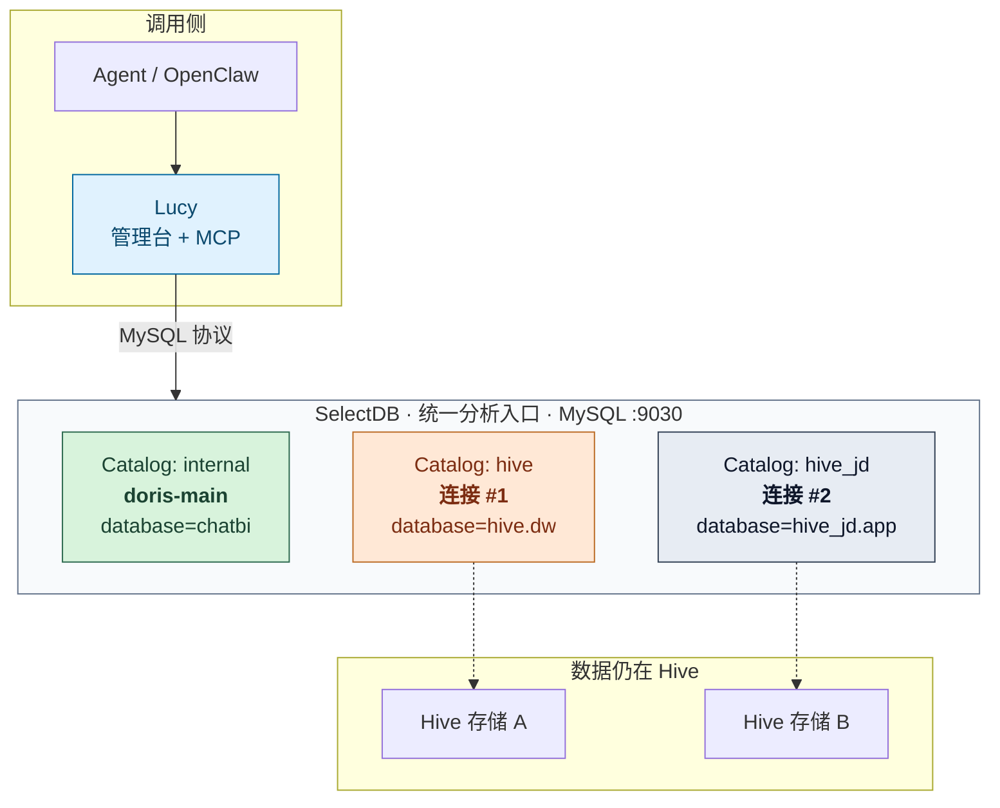
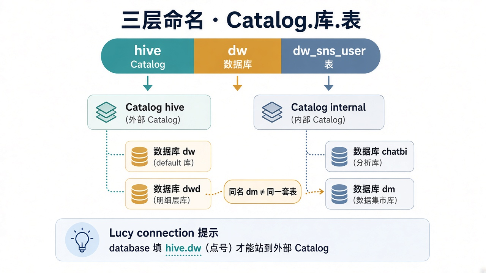
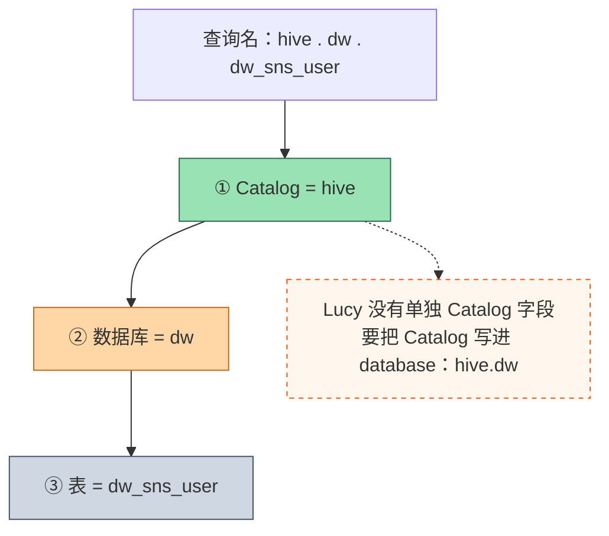
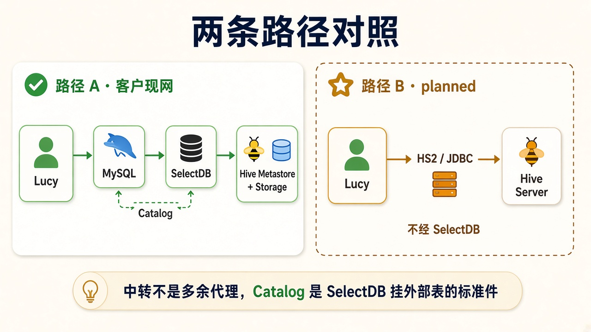
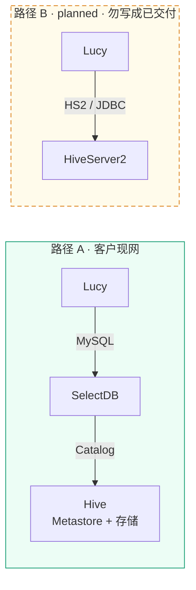
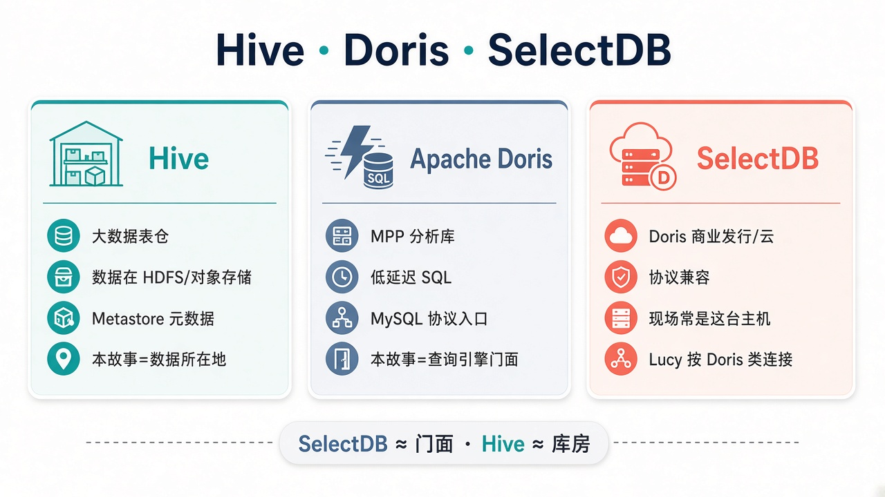
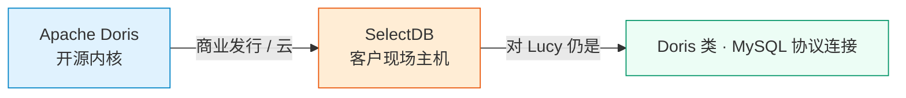
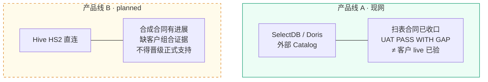
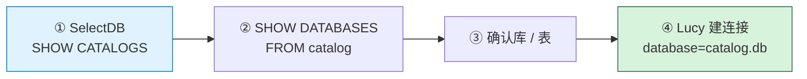

# 数据架构调研分析

> **副题**: SelectDB 外部 Catalog、Hive 与 Lucy 连接边界  
> **状态**: 调研分析（已落盘）  
> **日期**: 2026-11-13  
> **性质**: 客户数据架构调研与概念对照。**不是 Spec**，不授权改代码，不构成客户验收或支持矩阵晋级。  
> **范围**: 客户经 SelectDB 外部 Catalog 访问两套 Hive 的路径；与 Lucy「Hive HS2 直连」产品线的边界；Hive／Doris／SelectDB 概念与用途；客户 Doris 升级／扩容版本备忘。  
> **客户 Doris 版本（口述／升级备忘）**: **2.0.14**（已升级并扩容）；社区／产品线当代主线已到 **4.x**——二者勿混为一谈。  
> **相关材料**:
> - 现场配置故事与建议：[2026-10-20-selectdb-hive-catalog-review.md](2026-10-20-selectdb-hive-catalog-review.md)
> - 库内扫表读法（事故修复合同）：[lucy-20261111-catalog-scan-read-path-spec.md](../specs/lucy-20261111-catalog-scan-read-path-spec.md)（P1-16／REQ-030-037；功能合同已收口 ≠ 客户 live 已验）
> - 数据库支持矩阵：[database-support-matrix.md](../governance/database-support-matrix.md) §3.1 Hive、§4.2 外部 Catalog
> - Hive HS2 直连（另一条产品线，`planned`）：[编译侧 Spec](../specs/lucy-20261025-v0p25-hive-direct-connection-spec.md) · [问数 Spec](../specs/lucy-20261030-hive-query-execution-spec.md)
>
> **曾用文件名**: `2026-11-13-selectdb-hive-external-catalog-architecture.md`（已更名为本文件）

---

## 1. 一句话结论

客户现场说的「Hive 连接」，**不是** Lucy 直连 HiveServer2，而是：

**Lucy 用 MySQL 协议连 SelectDB；SelectDB 用外部 Catalog 去读两套 Hive 上的表。**

「经 SelectDB 中转」不是多余代理，而是客户已经选定的**统一分析入口**；外部 Catalog 正是 Doris／SelectDB 把 Hive 挂进该入口的标准机制。

---

## 1.1 客户 Doris 升级／扩容版本备忘

| 项 | 记录 |
|---|---|
| 客户动作 | 已做 **Doris 升级**与**扩容**（强化分析门面算力／稳定性；不替代 Hive 存数） |
| **客户现场版本** | **2.0.14** |
| 当代主线参照 | Apache Doris／相关商业线宣传与社区主线已到 **4.x** |
| 怎么读这个差距 | **2.0.14 是客户现网运行版本**；**4.x 是业界当前大版本世代**。排障、Catalog 能力（如 `default_init_catalog`）、文档对照时，以客户 **2.0.14** 为准，勿默认客户已在 4.x |
| 取证状态 | 本条为会话备忘落盘；**尚未**用客户侧 `SHOW VARIABLES`／管理台截图做二次核验。核验后把证据链补进本表或现场评审附录 |

升级／扩容增强的是 **Doris／SelectDB 门面**；Hive 仍是 Catalog 背后的数据所在地。概念对照见 §4。

---

## 2. 数据平面怎么叠

> 一眼看懂：应用只看见一台 SelectDB；两套 Hive 以两个外部 Catalog 挂在门面后面。

### 三层命名：Catalog．库．表

Studio 里可直接跑：`hive.dw.dw_sns_user`。  
`internal.dm` 与 `hive.dm` 可以同名，但是**两套表**。

Lucy 的「连接」只记录「连哪台」和「哪个 database」。要站到外部目录，须用点号形态 `catalog.database`，或依赖账号的 `default_init_catalog`（版本能力须现场验证）。

---

## 3. 为什么经 SelectDB，而不是直连 Hive？

### 3.1 Catalog 是谁的功能

**外部 Catalog 是 Doris／SelectDB 的概念，不是 Hive 的概念。**

SelectDB 登记「外面还有一套元数据／表」；查询时由 **SelectDB** 去连 Metastore、读存储，再把 SQL 结果返回给调用方。

「为什么中转」＝「为什么客户用 SelectDB 当统一 SQL 引擎」；Catalog 是该引擎挂外部表的**标准件**，不是多余跳板。

### 3.2 客户侧常见动机

| 动机 | 说明 |
|---|---|
| 统一入口 | `internal` 与 `hive`／`hive_jd` 同一端口、同一套 SQL／账号／审计 |
| 引擎能力 | 缓存、优化、联邦由 SelectDB 承担；应用侧仍只说 MySQL 协议 |
| 运维边界 | Kerberos、Metastore、存储权限收在数仓；应用只暴露一个分析库地址 |
| 多套 Hive | 在 SelectDB 里＝多个 Catalog；Lucy 各建一条连接即可 |
| 与现有工具一致 | Studio、看板已按 `hive.库.表` 查询；Lucy 跟同一入口 |

### 3.3 为何当前不主张「Lucy 直接连两个 Hive」

| 维度 | 经 SelectDB Catalog | Lucy → Hive HS2 直连 |
|---|---|---|
| 客户架构 | 已挂好 `hive`／`hive_jd` | 需另开 HS2 地址、认证、网络 |
| 协议 | MySQL／Doris 类（与 `doris-main` 同族） | HiveServer2／JDBC |
| Lucy 支持状态 | **现网在用的路径** | 支持矩阵 **`planned`**：不得写成正式支持／已上线 |
| 两个 Hive | 两个 Catalog → 两条 Lucy 连接 | 理论上可两条直连，但产品未作客户交付主张 |

直连不是「技术上永远不行」，而是：**现网数据平面没选这条；Lucy 正式可交付的也不是这条。**  
若未来客户愿意且产品把 HS2 晋级为正式支持，那是**换接入形态**，不是「去掉一层多余中转」。

---

## 4. 概念对照

### 4.1 Hive 与 Doris

| | Hive | Doris |
|---|---|---|
| 定位 | 大数据仓库层：表多在 HDFS／对象存储，元数据在 Metastore | MPP 分析型数据库：自有存储与计算，面向低延迟 SQL |
| 典型用法 | 批处理、ETL、大数据集离线／近线 | 交互式查询、报表、近实时分析 |
| 查询入口 | HiveServer2、Spark／Presto／引擎联邦等 | MySQL 协议端口等 |
| 在本故事中 | **数据所在地**（外表仍在 Hive） | **查询引擎／统一入口**（经 Catalog 读 Hive） |

**SelectDB ≈ 门面 · Hive ≈ 库房。**

### 4.2 SelectDB 与 Doris

| | Apache Doris | SelectDB |
|---|---|---|
| 是什么 | 开源 MPP 分析库 | 基于 Doris 的商业产品／云服务 |
| 关系 | 上游开源内核 | 兼容 Doris 协议与大量 SQL／Catalog 能力 |
| 对 Lucy | 连接类型按 Apache Doris／MySQL 协议配置 | 现场主机常为 SelectDB；**对 Lucy 仍按 Doris 类连接使用** |

对 Lucy 几乎是同一类协议与用法；差别主要在发行版、商业能力与部署形态。

---

## 5. Lucy 侧两条产品线（勿混写）

| 产品线 | 含义 | 现状（落盘日口径） |
|---|---|---|
| **A. SelectDB／Doris 外部 Catalog** | MySQL 协议；`database`＝`catalog.database`；管理侧扫表见 Spec | 客户现网；扫表**功能合同已收口**；UAT **PASS WITH GAP**；**≠ 可上线** |
| **B. Hive HS2 直连** | JDBC 问数，不经 SelectDB Catalog | **`planned`**；缺客户组合证据，不得晋级 |

问数（MCP → KTX）与「库内表清单／准备表结构」是不同面：

- P1-16 改的是管理侧 `live-schemas`／`live-tables`／`schema-structure`；**合同写明不改问数、不改 KTX、不改 MCP**。
- 外部目录列库／列表走 Lucy 直连 `SHOW`（`ktx sql` 拒 `SHOW`；外部目录无可用的 `information_schema` 成功路径）；已知表 `DESC` 仍可走 `ktx sql`。

---

## 6. 连接配置要点（架构层）

1. **一条 Lucy 连接 ≈ 一次登录后站在一个 Catalog 语境。**  
   要同时用 `hive` 与 `hive_jd`，通常各建一条连接。
2. **`database` 必须表达目标目录。**  
   只填 `dm`、连接名叫 `hive`，登录后仍可能在 `internal`，Schema 下拉会是 `chatbi`／`ods`，而不是 `dw`／`dwd`。
3. **先在 SelectDB 侧验证，再在 Lucy 建连接。**  
   可选账号 `default_init_catalog`（依赖版本；未验证前不得假定成立）。
4. **外部目录表一般只读。**

细节见 [2026-10-20 评审](2026-10-20-selectdb-hive-catalog-review.md)；扫表语句合同见 [catalog-scan Spec](../specs/lucy-20261111-catalog-scan-read-path-spec.md)。

---

## 7. 诚实主张边界

| 可以主张 | 不可以主张 |
|---|---|
| 客户经 SelectDB Catalog 访问两套 Hive 的**架构解释**已写清 | 「外部 Catalog live 已在客户环境复测通过」 |
| 管理侧扫表读法相对 Spec 的**功能合同**已收口 | 「Hive 已正式支持」或「HS2 直连可上线」 |
| MCP／KTX 问数路径按合同**不在**扫表修复改动面内 | 「功能合同收口＝可上线」 |

客户级关闭「SelectDB＋Hive 扫表已修好」：须真实环境复测（或委托人书面接受 UAT GAP）。路径见测试台 `UAT-SUITE-CATALOG-SCAN`。

---

## 8. 图示资产

| 文件 | 内容 |
|---|---|
| [assets/selectdb-hive-data-plane.jpg](assets/selectdb-hive-data-plane.jpg) | 客户现网数据平面总图 |
| [assets/selectdb-three-layer-naming.jpg](assets/selectdb-three-layer-naming.jpg) | Catalog．库．表 命名 |
| [assets/selectdb-hive-two-paths.jpg](assets/selectdb-hive-two-paths.jpg) | 现网 Catalog vs HS2 直连 |
| [assets/hive-doris-selectdb-concepts.jpg](assets/hive-doris-selectdb-concepts.jpg) | Hive／Doris／SelectDB 概念卡 |

正文同时保留 Mermaid，便于在 GitHub／IDE 预览中无图时也能读结构。

---

## 9. 变更记录

| 日期 | 说明 |
|---|---|
| 2026-11-13 | 初稿：落盘架构讨论 |
| 2026-11-13 | 增补 Canva 风格架构图 4 张 + Mermaid 结构图；图文对照 |
| 2026-11-13 | 登记客户 Doris 升级／扩容后版本 **2.0.14**；注明当代主线已到 **4.x**，现网以 2.0.14 为准 |
| 2026-11-13 | 正题更名为 **数据架构调研分析**；文件更名为 `2026-11-13-data-architecture-survey-analysis.md` |
