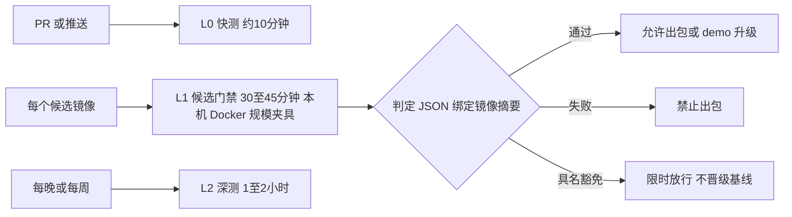

# Lucy 镜像能力测试与门禁现状审阅

| 元数据 | 内容 |
|---|---|
| 文档名称 | Lucy 镜像能力测试与门禁现状审阅 |
| 文档类型 | Review |
| 版本 | v1.0 |
| 撰写日期 | 2026-11-24 |
| 撰写人 | Claude（Cursor Agent） |
| 委托人 | xingchen |
| 基于材料 | `.github/workflows/lucy-*.yml`；根与 `webui/` 的 `package.json` 脚本；`scripts/upgrade/`、`scripts/gates/`、`scripts/e2e/`、`scripts/uat/`；`webui/scripts/release-perf-baseline.mts`；`docs/qa/mcp-compat-clients.yaml`、`docs/qa/real-e2e-clients.yaml`；`docs/runbooks/customer-amd64-image-build-checklist.md`；`docs/lessons/` 2026-11-13 至 2026-11-23 条目；执行总账 P1-13／53／54／67／75／78／79／81／82；本机 demo 容器 `/data/lucy` 目录结构；`lucy-v0.30` 分支 git 历史 |
| 适用范围 | 立项输入：为「镜像候选门禁」（总账 P1-86）与「门禁速赢四项」（总账 P1-87）提供现状诊断与行业对照。**过程审阅，不是功能合同；不构成终稿确权或开发授权** |
| 输出位置 | `docs/reviews/2026-11-24-image-candidate-gate-review.md` |

## 0. 结论

Lucy 的问题是测试资产多，但没有一道**每个镜像出厂前必须通过、并且绑定到这个镜像摘要的能力门禁**，而不是测试资产不够。现有约 200 个 npm 脚本、50 余个 UAT 套件、发布性能基线和 MCP 升级兼容门禁，大多按事故逐个建设、按需手动执行。真实出包路径只强制执行打包正确性检查（G1–G8），不强制能力检查。

因此，2026-11-13 至 2026-11-23 的错题本中有 15 条标记 `gate-gap`，复盘结论高度一致：修复在 demo 或热态下验证过，但没有在客户规模、读写同窗、冷启动或真实客户端下复验。

建议分两步处理：

1. **速赢四项**（P1-87）：修 CI 触发分支、迁出性能基线、升级后默认跑 MCP 兼容、升级保护校验改为语义校验。每项改动小、独立有效。
2. **镜像候选门禁**（P1-86）：把现有资产收拢为 L0／L1／L2 三层，以镜像摘要为单位产出判定。L1 必须包含 WebUI 真实浏览器测试与 MCP 真实客户端问询测试，环境对齐本机 Docker。

## 1. 背景与范围

- 起因：委托人反馈过去一周频繁出现 503、MCP 阻塞等问题，严重影响客户体验，要求盘点镜像后能力测试的系统性缺口。
- 关注维度：性能（WebUI 页面速度、不少于 2 个 Agent 客户端的问数与追问速度）、审计（新老功能审计日志不缺失）、功能（平滑升级不丢数据）、兼容性（数据库、Agent 客户端）。
- 环境口径：按仓库「Docker 对齐」原则，门禁以本机 compose／demo 为执行环境。客户 K8s 拓扑相关门禁（P1-83 等）不在本文建议范围内，只在第 6 节列出关系。

## 2. 现状盘点

### 2.1 真实出包路径没有能力门禁

- **事实**：`lucy-release.yml` 的设计包括同一摘要、只 promote 不重建、真实客户端 E2E 和证据签名。但 `real-e2e` 依赖 `[self-hosted, lucy-protected, linux, amd64]` runner；[`lucy-ci-restoration-spec`](../specs/lucy-ci-restoration-spec.md) §150 写明设施未齐时发布路径保持 BLOCKED。
- **事实**：客户镜像实际按 [`customer-amd64-image-build-checklist`](../runbooks/customer-amd64-image-build-checklist.md) 在 Mac 上手工构建。硬门禁 G1–G4b、G8 检查的是架构、ELF、ktx 版本、Python 运行时、K8s 契约；能力相关只有 G5 `smoke:p0:docker`，标注为「全绿（推荐）」。
- **影响**：性能、审计、升级数据、兼容性都不在出包的必经路径上，是否执行取决于当次执行人。

### 2.2 日常 CI 很可能没有覆盖 0.30 分支

- **事实**：`lucy-ci.yml` 的 push 触发分支为 `main` 和 `lucy-v0.25`。文件注释写明该临时入口在 0.25 不再是集成分支时删除，但没有替换为 `lucy-v0.30`。
- **事实**：`lucy-v0.30` 自 2026-11-14 起有 160 个提交，`Merge pull request` 类提交为 0，其余合并均为本地 merge（如「Merge readyz and MCP drain repairs into 0.30」）。
- **已核实（`gh run list`，2026-11-24）**：Actions 历史中 `lucy-v0.30` 分支的 push 运行为 0 次。全仓最近一次运行是 2026-11-19 的 PR #65（`fix/port-84becc34-execution-runtime-notranslate` → `lucy-v0.30`，仍 OPEN），`ci-required` 失败，失败任务为 `workflow-contracts`、`docker-smoke`、`k8s-upgrade-gate`。再往前是 2026-11-11 的 PR #64（→ `lucy-v0.25`，已关闭），`spec-and-webui` 失败。最近一次 push 运行是 2026-11-10 的 `lucy-v0.25`，结果为失败。也就是说，0.30 的 160 个提交没有经过任何 CI，最近两次能看到的 CI 结果都是红的。
- **已核实**：最近一次发布流水线（`v0.25.0` tag，2026-11-06）`customer-amd64-native` 与 `release / spec-and-webui` 失败，`real-e2e`、`customer-release-readiness`、`release-package` 均为 skipped。
- **事实**：即使触发，日常 CI 也以文档与契约检查为主（spec／状态词／术语 lint、vitest、build、Docker smoke、MySQL 与 PG demo smoke、kind 升级），不含性能、Playwright、真实 Agent、审计覆盖；没有 `schedule` 定时任务。`webui` 已有 `e2e:smoke`（`@pr-smoke`）和 `e2e:nightly`，均未接入 CI。

### 2.3 性能基线覆盖窄，锚点不可靠

- **事实**：`perf:release-baseline`（P1-13／REQ-030-034）只覆盖 Roles 的 API 热读、Roles 页面冷读（`primaryReadyMs`）、MCP `initialize`、`tools/list`。`navigation.ts` 中约 75 个 `path:`，其余页面和二级 Tab 均不在内。
- **事实**：正式基线是 2026-11-13 采集的 `0.30.0-cb9c53d04d6f`，存放在被 `.gitignore` 忽略的 `inbox/perf-baselines/formal/`。按 `AGENTS.md`，`inbox/` 是可以随时删除的临时目录，相对退化判定的锚点随时可能丢失。
- **事实**：P1-67（WebUI 用户旅程性能门禁）仍为 S1 草稿；P1-78（MCP 问询性能基线）已终稿确权（S2），开发未授权，未执行跑次。
- **事实**：默认 demo 为 lean 模板，规模档 `--scale` 需手动开启。11-20、11-23 的事故只在规模下复现（500 Agent、200 角色、2,006 张表、约百万条审计）。
- **缺口**：没有在门禁中度量事件循环延迟和按路由的 5xx／503 计数，而 11-13、11-17、11-20、11-23 四起事故的共同机理都是事件循环被同步工作占满。

### 2.4 WebUI 与 MCP 真实测试存在，但不是每个镜像必跑

- **WebUI**：`e2e:real:management`、`e2e:release-ux`、Playwright `@pr-smoke`，以及多个 UAT 页面探针（`page-open-probe`、`page-dom-probe`、`interactive-read-resilience`）。没有一份固定的全页面清单，没有在每个镜像上执行。
- **MCP**：`e2e:real:agent`、P1-53／P1-54 的升级兼容题库（34 题）、P1-78 的性能设计。[`mcp-compat-clients.yaml`](../qa/mcp-compat-clients.yaml) 规定每次运行只选一个客户端、结果不外推；[`real-e2e-clients.yaml`](../qa/real-e2e-clients.yaml) v5 的必选对（Claude Code＋OpenClaw）只在处于 BLOCKED 状态的 `real-e2e` 任务中使用。委托人要求的「不少于 2 个客户端」目前没有任何必跑路径满足。

### 2.5 审计没有覆盖契约

- **事实**：审计写入分散在约 20 个函数中，例如 `recordRequestAudit`（56 处调用）、`recordAuthEvent`（17）、`recordAccountEvents`（6）、`writeTraceEvent`（6）。审计数据分布在 `audit.sqlite`（`access_log`、`auth_failure_log`、`conversation_turns` 等）和 `security.sqlite`（`security_events` 等）。
- **缺口**：没有「哪个写操作或 MCP 工具必须产生哪种审计事件、带哪些必填字段」的登记表，也没有测试枚举路由和工具来核对覆盖。新功能漏写审计不会被任何检查发现。
- **旁证**：[11-18 审计页崩溃](../lessons/2026-11-18-audit-calls-render-crash-misreported.md)的原因是合并进来的 `auth_failure` 行缺 `tool` 字段，说明事件结构也没有校验。

### 2.6 平滑升级的保护校验几乎检测不到丢数据

- **事实**：`scripts/upgrade/upgrade-lucy-lib.mjs` 的 `PRESERVE_REL_PATHS` 只有 7 项：`ktx.yaml`、`webui/config/access.yaml`、`webui/config/admins.yaml`、`.ktx-ui/audit.sqlite`、`.ktx-ui/webui-session-secret`、`.ktx-ui/ktx-internal-token`、`.ktx/secrets`。`diffPreserveSnapshots` 只判断「存在，且文件字节数或目录文件数不缩小」。
- **缺口一**：SQLite 删除行后默认不收缩文件，近期写入还可能只在 `-wal` 中，所以 `audit.sqlite` 丢行时字节数不会变小，校验照样通过。
- **缺口二**：本机 demo 卷 `/data/lucy` 中的 `.ktx-ui/security.sqlite`（`admin_account_state`、`admin_sessions`、`bootstrap_state`、`security_events`、`wiki_access_*`）以及 `wiki/`、`semantic-layer/`、`skills/`、`evals/` 都不在清单内。
- **缺口三**：不校验语义：管理员数、ACL 条目、升级前签发的 Token 能否继续使用、已撤销的 Token 是否仍被拒。
- **事实**：升级后的 MCP 兼容钩子默认关闭，需要设置 `LUCY_MCP_COMPAT=1`。升级起点只有当前卷；[11-18 回退基线缺修复](../lessons/2026-11-18-rollback-baseline-lacks-external-catalog-field-fix.md)说明现场版本、回滚版本需要单独纳入。

### 2.7 兼容性靠手动或单点

- **数据库**：CI 只跑 MySQL demo 与 PG demo。StarRocks（`r1:starrocks-smoke`、`smoke:p1:starrocks-certification`）、Doris（`r1:doris-smoke`）、Hive 外部目录（`setup-doris-hive-catalog.sh`）、MySQL 版本矩阵（`run-mysql-version-matrix.sh`）都是手动脚本。[11-13 外部目录读不出字段](../lessons/2026-11-13-external-catalog-column-read-ktx-describe.md)的原因是测试替身比真实 KTX 宽松（真实 `ktx sql` 拒绝 `DESC`）。
- **Agent 客户端**：见 2.4。另外没有对 `initialize` 指引和 `tools/list` schema 做快照比对，工具面的破坏性变更只能靠真实客户端跑出来。

### 2.8 测试资产的形态：一次性套件多，常驻回归包缺失

- `docs/qa/uat/suites/` 下约 50 个套件，大多对应单个事故或单个 P1 条目，有各自的 runner 和夹具。修复收口后不会在下一个镜像上重跑。
- 结果是同一类问题（规模、冷读、写入同窗）在 P1-13 → P1-58 → P1-66 → P1-75 上反复出现。[11-20 Roles 卡顿被误判为已修](../lessons/2026-11-20-roles-lag-p113-claimed-fixed-still-slow.md)、[11-23 名册 503 与 MCP 长尾](../lessons/2026-11-23-roster-busy-and-mcp-latency.md)都是这个模式。

## 3. 近两周事故与漏检映射

| 错题 | 漏检类型 | 能拦住它的门禁项 | 层级 |
|---|---|---|---|
| [11-13 审计重算占住事件循环](../lessons/2026-11-13-audit-read-blocks-event-loop.md) | 规模＋事件循环 | 规模夹具＋事件循环延迟断言 | L1 |
| [11-13 外部目录读字段](../lessons/2026-11-13-external-catalog-column-read-ktx-describe.md) | 测试替身宽松 | 真实引擎兼容矩阵 | L1／L2 |
| [11-16 表级歧义门闩死路](../lessons/2026-11-16-source-ambiguity-gate-deadlock.md) | 纯 MCP 主路径 | 真实客户端问数题库 | L1 |
| [11-17 K8s 升级 readyz 超时](../lessons/2026-11-17-k8s-upgrade-event-loop-readiness-timeout.md) | 冷启动＋慢盘 | 升级后冷启动＋事件循环断言（Docker 档） | L1 |
| [11-17 复制假成功](../lessons/2026-11-17-clipboard-http-fake-success.md)／[按钮静默失败](../lessons/2026-11-17-button-feedback-silent-failure.md) | 只看 Toast | 浏览器功能断言看实际结果 | L1 |
| [11-18 审计页渲染崩溃](../lessons/2026-11-18-audit-calls-render-crash-misreported.md) | 事件结构＋页面巡检 | 审计事件 schema 校验＋全页面巡检 | L0／L1 |
| [11-18 回退基线缺修复](../lessons/2026-11-18-rollback-baseline-lacks-external-catalog-field-fix.md) | 升级起点单一 | 现场版本作为升级起点＋回滚校验 | L2 |
| [11-20 readyz 超时与 MCP 排空](../lessons/2026-11-20-readyz-timeout-and-mcp-drain-gap.md) | 尾延迟 | 事件循环断言＋503 计数为 0 | L1 |
| [11-20 Roles 误判已修](../lessons/2026-11-20-roles-lag-p113-claimed-fixed-still-slow.md) | 规模＋冷读 | 规模夹具＋冷读页面计时＋相对基线 | L1 |
| [11-22 问询预算粘连](../lessons/2026-11-22-question-budget-exhausted-recurring.md) | 跨跑次状态 | 真实客户端多轮追问＋预算续问 | L1 |
| [11-23 名册 503 与 MCP 长尾](../lessons/2026-11-23-roster-busy-and-mcp-latency.md) | 读写同窗 | 读写同窗场景 | L1 |

## 4. 行业做法对照

| 做法 | 行业常见形态 | Lucy 现状 | 差距 |
|---|---|---|---|
| 分层测试与发布火车 | PR 快测 → 合并后 nightly → 候选版本门禁，判定绑定制品摘要 | 发布流水线设计到位但 BLOCKED；日常 CI 未覆盖 0.30 | 实际出包路径没有能力门禁 |
| 只 promote 不重建 | 测过的摘要直接打发布标签 | `release-package` 已实现 | 实际出包走手工构建，未复用 |
| 持续性能基准 | k6／Locust 压 API，Lighthouse CI 或 Playwright 计时测页面；基线进仓库；绝对 SLO 加相对退化阈值 | 3 条路径、基线在临时目录、11-13 后未更新 | 覆盖面和锚点都不足 |
| 服务级指标做门禁 | 事件循环延迟、按路由错误率作为 SLI，压测期间断言 | 未接入门禁 | 最常见的事故机理没有被直接度量 |
| 生产形态数据 | 合成的规模夹具默认开启，覆盖冷热两态 | 规模档需手动开启 | 默认测试在轻负载下进行 |
| 审计即契约 | 写操作 → 审计事件的登记表，测试枚举覆盖；事件 schema 校验；按请求对账 | 写入分散，无登记、无覆盖测试 | 新功能漏审计无法发现 |
| 升级数据保护 | 语义快照（行数、校验和、凭据可用性），N-1 与现场版本为起点，含回滚 | 7 个路径的字节数检查 | 丢行、漏文件、凭据失效都测不出 |
| 兼容矩阵 | 真实引擎容器矩阵；消费者驱动契约；客户端版本固定 | 两种数据库进 CI；客户端每次一个 | 真实引擎与多客户端都缺 |
| 回归沉淀 | 每个事故的回归用例进常驻回归包 | 每个事故一个独立套件 | 修完不再重跑 |

## 5. 建议

### 5.1 速赢四项（总账 P1-87；每项可单独授权）

| 编号 | 改动 | 验证方式 |
|---|---|---|
| Q1 | `lucy-ci.yml` push 触发分支从 `lucy-v0.25` 改为 `lucy-v0.30`，并加每日 `schedule`。最近两次 CI 均为红，接通后要先把 0.30 跑绿，否则红灯会被当成噪音忽略 | 推送后 Actions 出现运行；`test:ci-workflow-contracts` 通过；`ci-required` 转绿 |
| Q2 | 正式性能基线从 `inbox/perf-baselines/formal/` 迁到受 git 跟踪的目录（只存 `report.json` 等小文件），`--previous` 默认指向它 | 清空 `inbox/` 后相对判定仍能找到锚点 |
| Q3 | 升级脚本中 `LUCY_MCP_COMPAT` 默认开启，显式设为 `0` 才跳过，跳过时输出醒目提示 | `upgrade-lucy.test.mjs` 增加默认开启用例 |
| Q4 | 升级保护校验改为语义快照：各 SQLite 表行数与 `max(rowid)`（先做 WAL checkpoint）；纳入 `security.sqlite`、`wiki/`、`semantic-layer/`、`skills/` 的文件树哈希；升级前签发的 Token 升级后能完成一次 MCP 调用 | 人为删除一行审计后升级，校验必须失败 |

### 5.2 镜像候选门禁（总账 P1-86；需 Spec／Plan）

要点：

- **L0（PR／推送）**：单测；审计登记表覆盖测试；MCP `initialize` 与 `tools/list` 快照比对；Playwright `@pr-smoke`。不调用模型。
- **L1（每个镜像，必跑）**，同一候选、规模夹具默认开启：
  1. **平滑升级**：从上一已接受版本的卷升级，执行 Q4 的语义快照比对。
  2. **WebUI 真实测试**：真实前台浏览器登录，遍历全部一级、二级页面和二级 Tab；计时到数据可见，冷读与热读分开，每页至少 20 个样本；典型治理操作真实点完，断言实际结果而不是 Toast。
  3. **MCP 真实问询**：至少 2 个真实 Agent 客户端（建议 Claude Code，加 Cursor 或 Codex 其一），调用真实模型，经 Public MCP Proxy 执行固定题库，覆盖单问、追问、多表澄清、无权限拒绝、预算续问；数据与金标准一致；记录握手、首个工具调用、整轮耗时。
  4. **读写同窗**：第 2、3 项进行时并发执行配置写入、名册编辑、语义发布。
  5. **审计对账**：脚本化执行 N 个已知操作，按 request id 核对期望事件与实际行一一对应，并校验事件 schema。
  6. **兼容性**：MySQL（5.7、8.0）、PG 真实引擎。
  7. **全程断言**：事件循环延迟 p99 和 max、按路由的 5xx／503 计数、进程重启次数。
- **L2（每晚或每周）**：1–2 小时 soak；StarRocks、Doris、Hive 外部目录；完整客户端池；现场版本作为升级起点与回滚校验。
- **判定**：数据正确性、阻塞和 503 是硬判据；模型措辞差异不算失败；耗时取多样本 p95，同时比较绝对预算与相对上一基线的退化幅度。
- **建议初值（待委托人冻结）**：页面与 MCP 的 p95 相对退化超过 15% 判红；L1 期间 503 为 0；事件循环 p99 低于 100 ms、max 低于 1 s。
- **回归沉淀规则**：此后每个事故修复都要把回归用例加入 L1 或 L2，不再新建一次性 UAT 套件作为唯一验证。

## 6. 与在途条目的关系

| 条目 | 现状 | 建议关系 |
|---|---|---|
| P1-13 发版性能基线 | X_REL；覆盖 3 条路径 | 作为 L1 性能项的起点，扩展覆盖面；Q2 解决锚点 |
| P1-53／P1-54 MCP 升级兼容与题库 | X_REL／S5 | 题库直接作为 L1 第 3 项输入；把「每次一个客户端」改为「至少两个」 |
| P1-67 用户旅程性能门禁 | S1 草稿 | 建议收拢进 P1-86；是否把 P1-67 标为被取代，待委托人裁定 |
| P1-75 全页面无 503 | S3 实现中 | X0 页面／Tab／API 矩阵作为 L1 第 2 项的页面清单来源 |
| P1-78／P1-79 MCP 性能基线与长追问题组 | S2 已确权，开发未授权 | 作为 L1 第 3 项和 L2 soak 的性能口径；P1-86 引用，不重写 |
| P1-81／P1-82 自愈与数据面舱壁 | S4 待验收 | 其 UAT 场景沉淀为 L1 第 7 项断言 |
| P1-83／P1-85 客户 K8s | S1 | K8s 拓扑门禁另层，不在 P1-86 范围 |

## 7. 证据边界

- 2.2 的 CI 运行情况已用 `gh run list`／`gh run view` 核实（2026-11-24）；未逐条下载失败日志，失败根因未分析。
- 本次审阅没有执行任何测试、构建或升级；第 5 节的阈值是建议初值，不是测量结论。
- 路由、页面、审计写入函数的数量来自 `rg` 静态统计，用于判断量级，不作为精确分母。

## 8. 待委托人裁定

1. P1-86 优先级：按 P1 登记，是否提级为 P0（发布底线）。
2. P1-67 是否收拢进 P1-86 并标为被取代。
3. L1 必跑的两个客户端选哪两个；模型调用的成本预算。
4. L1 的执行机器与资源规格是否固定（性能比对要求同一参考机）。
5. 在 `real-e2e` runner 建成之前，是否承认「本机 Docker L1 判定」为当前出包的必要条件，并写入发版台账。
6. 速赢 Q1–Q4 是否逐项授权开发。
