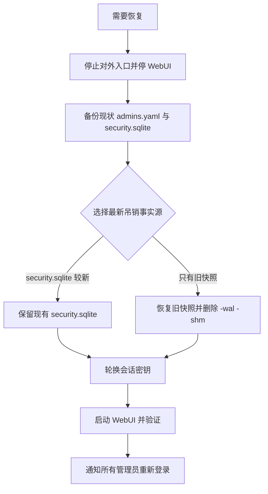

# WebUI 管理会话撤销与受控恢复 Runbook

| 元数据 | 内容 |
|---|---|
| 文档名称 | WebUI 管理会话撤销与受控恢复 Runbook |
| 文档类型 | Checklist |
| 版本 | v1.0 |
| 撰写日期 | 2026-10-18 |
| 撰写人 | Claude |
| 委托人 | xingchen |
| 基于材料 | [企业安全 Spec v0.2 §3.2](../specs/lucy-20261018-enterprise-security-and-real-e2e-spec.md)、[Plan v0.2 T03](../plans/2026-10-18-enterprise-security-and-real-e2e-plan.md)、`webui/server/auth/{session,account-state,guard,routes}.ts`、`webui/docs/04-data-model.md` §10 |
| 适用范围 | 管理员（owner / operator）WebUI 会话被吊销、安全库或管理员配置需要从备份恢复、安全库不可用时的运维处置；不覆盖 MCP Token |
| 输出位置 | `docs/runbooks/webui-session-recovery-runbook.md` |

## 1. 事实源与原则

| 事实源 | 位置 | 作用 |
|---|---|---|
| 会话 / 账户状态 | `<projectRoot>/.ktx-ui/security.sqlite`（`admin_sessions`、`admin_account_state`） | **最新吊销事实源**：每个请求都查；记录 jti 哈希、`session_epoch`、`revoked_at`、账户 `enabled/disabled/tombstoned` |
| 管理员账户 | `webui/config/admins.yaml` | 账户可读 id、`account_uid`（不可变）、角色、密码哈希；每个请求新读，不走 5 秒展示缓存 |
| 会话签名密钥 | `.ktx-ui/webui-session-secret`，或环境变量 `LUCY_WEBUI_SESSION_SECRET` | 至少 32 字节；**更换密钥 = 所有现存 Cookie 立即失效** |

原则：

1. 服务端吊销是唯一事实；清除浏览器 Cookie 不等于吊销。
2. 任何恢复动作都必须以「**更严格**」为方向：宁可让所有人重新登录，也不能让已吊销的会话复活。
3. 不要通过清空 `admins.yaml` 让任何人重新认领；首次引导已持久消费（`BOOTSTRAP_CONSUMED`）。
4. 本 Runbook 的任何命令不得打印密码、Cookie 或密钥内容。

## 2. 常规情形（无需运维介入）

| 操作 | 服务端行为 |
|---|---|
| 用户点击退出 | 先在安全库**耐久吊销**当前 jti，成功后才返回 200 并清 Cookie；吊销失败返回 `503 AUTH_STATE_UNAVAILABLE`，Cookie 保持不变 |
| owner 重置密码 / 修改角色 | 先提升该账户 `session_epoch`（旧会话全部失效），再写 `admins.yaml`；写失败时旧会话仍已失效 |
| owner 停用账户 | 先将账户置 `disabled` 并提升 epoch，再写配置；重新启用不会让旧会话复活，需重新登录 |
| owner 删除账户 | 先写 tombstone（`account_uid` 永不复用），再写配置；同 id 重建会得到新 `account_uid`，旧 Cookie 无效 |
| 空闲 30 分钟 / 绝对 12 小时 | 过期会话返回 `401 AUTH_REQUIRED`，前端回到登录页 |

## 3. 受控恢复：从备份恢复 `security.sqlite` 或 `admins.yaml`

适用：磁盘损坏、误删、回滚到旧卷快照。恢复旧文件**可能让旧的、已吊销的会话重新可用**，所以必须轮换会话密钥。



步骤：

1. **停服**：先摘除入口（Ingress / 反代 / 端口映射），再停止 WebUI 进程或 Pod。不得在服务运行时替换数据库文件。
2. **备份现状**（即使它已损坏，也不要直接删除）：
   ```bash
   cd <projectRoot>
   ts=$(date +%Y%m%d%H%M%S)
   cp -p webui/config/admins.yaml "webui/config/admins.yaml.bak.$ts"
   cp -p .ktx-ui/security.sqlite "inbox/security.sqlite.bak.$ts" 2>/dev/null || true
   ```
3. **选择最新吊销事实源**：
   - 现有 `security.sqlite` 能正常打开 → 以它为准，**不要**用旧快照覆盖它。
   - 只有旧快照 → 恢复它，并同时删除遗留的 `.ktx-ui/security.sqlite-wal` 与 `-shm`；文件权限保持 `0600`，`.ktx-ui` 目录 `0700`。
   - `admins.yaml` 以最近一次已知正确的版本为准；不要手工删除条目里的 `account_uid`。
4. **轮换会话密钥**（二选一，必做）：
   - 文件密钥：删除 `.ktx-ui/webui-session-secret`，启动时自动生成新的 32 字节随机密钥。
   - Secret 注入：更换 `LUCY_WEBUI_SESSION_SECRET` 的值（至少 32 字节），再滚动重启。
5. **启动并验证**（见 §6）。
6. **通知所有管理员重新登录**；记录操作人、时间、备份路径（不要记录密钥或密码）。

## 4. 安全库不可用（`503 AUTH_STATE_UNAVAILABLE`）

现象：已登录用户请求、登录、退出返回 `503 AUTH_STATE_UNAVAILABLE`；无 Cookie 的请求仍是 `401`。这是**有意的失败关闭**：系统不会把它当成「没有管理员」或「放行」。

排查（只读，不要删除数据库）：

1. 磁盘是否写满、卷是否只读、`.ktx-ui/` 目录与 `security.sqlite(-wal|-shm)` 权限是否分别为 `0700` / `0600`，所属用户是否为运行用户。
2. 是否有其他进程占用数据库（`busy`）；是否为符号链接（`path_unsafe`，系统拒绝使用符号链接路径）。
3. 如已安装 `sqlite3`，只读检查完整性：
   ```bash
   sqlite3 -readonly .ktx-ui/security.sqlite "PRAGMA integrity_check;"
   sqlite3 -readonly .ktx-ui/security.sqlite "SELECT display_id, session_epoch, status FROM admin_account_state;"
   ```
4. 环境变量 `LUCY_WEBUI_SESSION_SECRET` 短于 32 字节同样返回 503：更换为至少 32 字节的 Secret。
5. 数据库确已损坏且无可用快照：按 §3 在受控停服下处理；不得清空 `admins.yaml`，也不得新建空数据库伪装恢复。

## 5. 升级到 v2 会话后的预期现象

- 升级后**所有旧会话（v1，无状态）一次性失效**，管理员需重新登录；业务 Agent Token 不受影响。
- 首次登录时，没有 `account_uid` 的旧账户会被自动分配并写入 `admins.yaml`（配置审计 `admin_uid_migrate`），此后不可变。
- 短于 32 字节的旧 `.ktx-ui/webui-session-secret` 会在首次签发新会话时自动轮换。
- 全部凭据丢失（无可登录的 owner）：本期**不提供**通过清空 `admins.yaml` 重新认领的路径。可行做法是 §3 的受控恢复（恢复含 owner 的最近 `admins.yaml` 备份并轮换密钥）。若没有任何可用备份，需要由后续的受控 break-glass 维护工具处理（待确认，不属于 T03）；原《系统手册》§3.5「路径 B」描述的清空流程与 `BOOTSTRAP_CONSUMED` 不一致，应在 T02/T03 之后的文档整理中修订。

## 6. 恢复后验证清单

| # | 检查 | 期望 |
|---|---|---|
| 1 | 用恢复前保存的旧 Cookie 请求 `GET /api/admin/admins` | `401 AUTH_REQUIRED` |
| 2 | 管理员重新登录并请求同一接口 | `200` |
| 3 | 响应头 `Cache-Control` | `no-store` |
| 4 | 退出后重放同一 Cookie | `401`；重启进程后仍为 `401` |
| 5 | `.ktx-ui` 与数据库权限 | `0700` / `0600` |
| 6 | 配置审计 | 有 `admin_*` 变更记录，且不含密码明文 |

示例（把 `$COOKIE` 换成真实值，勿写入日志）：

```bash
curl -s -o /dev/null -w "%{http_code}\n" -H "Cookie: lucy_admin_session=$COOKIE" https://<lucy-host>/api/admin/admins
```

## 7. 演练（OPS-01 / SEC-04）

每季度或升级前，在非生产环境完成一次：

1. 登录两个账户，记录各自 Cookie。
2. 退出其中一个，确认重放 `401`，重启后仍 `401`。
3. owner 重置另一账户密码，确认旧 Cookie `401`。
4. 备份 `security.sqlite`，退出另一会话，停服后用备份覆盖并**不**轮换密钥，观察旧 Cookie 可能复活（证明为什么必须轮换）；再删除 `webui-session-secret`、重启，确认旧 Cookie `401`。
5. 记录耗时与偏差，写入演练记录（不含 Cookie 与密钥）。
